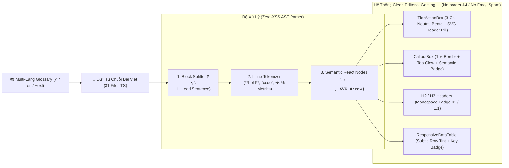

# 📘 Master Plan & Đặc Tả Cải Tổ Toàn Diện Cẩm Nang (`Guides Hub v4.0`) — Rich HTML Engine, Clean Editorial Gaming UI & Chuẩn Hóa Đa Ngôn Ngữ

> **Version:** 4.0 (Editorial HTML, De-AI UI Overhaul & Multi-Language Glossary Master Plan) · **Ngày cập nhật:** 2026-10-17 · **Trạng thái:** ✅ **HOÀN TẤT (`5/5 Waves Completed` — Toàn bộ Wave 1, Wave 2, Wave 3, Wave 4, Wave 5 đã nghiệm thu 100%)**
> **Liên quan:** [guides-uiux-redesign-master-plan.md](guides-uiux-redesign-master-plan.md) · [Wave 1 Plan](2026-10-16-wave1-hardening-implementation-plan.md) · [Wave 2 Plan](2026-10-16-wave2-clean-editorial-ui-and-layout-overhaul-plan.md) · [Wave 3 Plan](2026-10-16-wave3-content-restructuring-group-1-to-4-plan.md) · [Wave 4 Plan](2026-10-16-wave4-content-restructuring-group-5-to-8-plan.md) · [Wave 5 Plan](2026-10-17-wave5-glossary-and-bilingual-purity-plan.md) · [Multi-Lang Glossary](top-heroes-multilang-glossary.md) · [guide-article-renderer.tsx](../../src/components/guides/guide-article-renderer.tsx) · [types.ts](../../src/content/guides/types.ts)

---

## 1. Tổng Quan & Các Quyết Định Đã Chốt Của Product Owner (Confirmed PO Decisions)

### 1.1. Mục Tiêu Cải Tổ (`Executive Summary`)
Sau khi hoàn thành 4 Phase của `Guides Hub v3.0` (Cấu trúc Layout 3 cột, Smart Command Hub, 3-Tab View Mode và 3 Interactive Widgets), đợt kiểm toán thực tế trên `http://localhost:3000/guides` đã phát hiện **5 nhóm vấn đề cốt lõi về chất lượng hiển thị văn bản, thẩm mỹ thị giác và độ tinh khiết đa ngôn ngữ**:
1. **Rò rỉ cú pháp Markdown thô (`**bold**`, `` `code` ``, `\n•`)** ra giao diện người dùng do dữ liệu chuỗi đang được render như plain text thuần.
2. **Đoạn văn dàn trải ("Wall of Text" 400–600 ký tự/khối)** trong các hộp `TldrActionBox`, `CalloutBox` và `paragraph`, gây mỏi mắt và khó nắm bắt nhanh các mốc điểm gãy số liệu.
3. **Hiển thị thừa mục nội bộ `"Nguồn dữ liệu chuẩn hóa"` (`sourceFiles`)** ở cuối mọi trang bài viết public.
4. **Dấu ấn thẩm mỹ AI ("AI-Generated UI Clichés"):** Lạm dụng dải màu dày bên trái (`border-l-4`, `border-l-2`) trên thẻ bo tròn, tô nền 3 màu đèn giao thông cạnh nhau và спаm Emoji trùng lặp ngay sát cạnh các biểu tượng vector `lucide-react`.
5. **Rò rỉ tiếng Việt sang trang tiếng Anh (`en`) & thiếu chuẩn thuật ngữ:** Tồn tại **264 chuỗi `en:`** trong 14 bài viết vẫn chứa ký tự tiếng Việt và chưa có bộ từ điển thuật ngữ chuẩn hóa từ cộng đồng quốc tế để sẵn sàng mở rộng đa ngôn ngữ.

### 1.2. Ba Quyết Định Thiết Kế Cốt Lõi Đã Được Product Owner Xác Nhận

| Mã Quyết Định | Hạng Mục Thiết Kế | Phương Án Đã Chốt (Confirmed by PO) | Chi Tiết Kỹ Thuật & Quy Chuẩn Áp Dụng |
| :--- | :--- | :--- | :--- |
| **DEC-V4-01** | **Phương thức chuyển đổi Markdown & Diễn đạt lại văn bản dàn trải sang Rich HTML** *(Yêu cầu 1 & 2)* | **Phương án A:** Kết hợp Bộ **`<RichGuideText />`** thông minh + **Biên tập lại (`Restructure`)** nội dung các khối `TL;DR` & đoạn văn dài thành cấu trúc HTML phân lớp | • Xây dựng component `<RichGuideText />` (`src/components/guides/blocks/rich-guide-text.tsx`) tự động phân tích cú pháp `**bold**`, `` `code` ``, `\n•`, `\n1.`, mũi tên `➔`, và các con số định lượng (`+30%`, `560 Mảnh`, `Lv.35`) để render thành các thẻ HTML ngữ nghĩa (`<strong>`, `<mark>`, `<kbd>`, `<ul>/<li>` gắn icon SVG, badge số liệu nổi bật).<br>• Biên tập lại (`Content Restructuring`) toàn bộ các đoạn văn dài trong 31 bài viết theo công thức: **1 câu kết luận in đậm ngắn gọn ở đầu + Danh sách Bullet Chips ngắn + Badge điểm gãy có hiệu ứng hover tinh tế**. |
| **DEC-V4-02** | **Phong cách Thiết kế Card/Khung mới thay thế cho kiểu "Dải màu bên trái (`border-l-4`)"** *(Yêu cầu 4)* | **Phương án A:** Phong cách **"Clean Editorial Gaming UI"** *(Lấy cảm hứng từ Prydwen / Maxroll / Vercel Docs)* | • **Xóa bỏ 100%** kiểu `border-l-4` / `border-l-2` trên các thẻ bo tròn (`TldrActionBox`, `CalloutBox`, `ResponsiveDataTable`, `HeroEncyclopediaWidget`) và trên tiêu đề `H2` / `H3` (`GuideArticleRenderer`).<br>• Thay bằng: **Nền trung tính (`bg-card` / `bg-muted/20`) + Viền mảnh đồng nhất `1px` (`border-border/80`) + Header Pill Badge chứa Icon SVG (`lucide-react`) + Hiệu ứng Top Glow / Hover Elevation tinh tế**.<br>• Tiêu đề `H2`/`H3` dùng **Badge số thứ tự Monospace (`01`, `1.1`)** kết hợp đường gạch chân mảnh (`border-b border-border/60`).<br>• **Cấm tuyệt đối** ghép Emoji (`🎯`, `📌`, `🔥`, `🚫`) đứng cạnh Icon SVG `lucide-react`. |
| **DEC-V4-03** | **Quy tắc Xử lý Thuật ngữ Game ở Bản Tiếng Việt (`vi`) & Bản Tiếng Anh (`en`) + Từ Điển Đa Ngôn Ngữ** *(Yêu cầu 5)* | **Phương án A (+ Bảng Từ Điển Chuẩn Hóa):** Bản `en` thuần Anh 100%; Bản `vi` ưu tiên tiếng Việt tự nhiên + Xây dựng **Bảng Từ Điển Thuật Ngữ Chuẩn (`Glossary`)** cho đa ngôn ngữ | • **Bản Tiếng Anh (`en`):** Thuần Anh **100%** (0 ký tự có dấu tiếng Việt trên toàn bộ 31 bài viết và các widget).<br>• **Bản Tiếng Việt (`vi`):** Ưu tiên tiếng Việt tự nhiên, mạch lạc; chỉ giữ tên riêng Tướng/Sự kiện tiếng Anh ở lần nhắc đầu tiên hoặc hiển thị qua Badge/Tooltip.<br>• **Đào sâu từ nguồn cộng đồng uy tín** (Official Top Heroes Discord, Reddit `r/TopHeroes`, Wiki/Guides quốc tế & cộng đồng Top Heroes Việt Nam) để thiết lập **Bảng Từ Điển Thuật Ngữ Đa Ngôn Ngữ (`src/content/guides/glossary.ts` & tài liệu chuẩn)** làm nền tảng mở rộng sang các ngôn ngữ khác (`ja`, `ko`, `zh`, `th`, `de`, `fr`...) trong tương lai. |

---

## 2. Báo Cáo Kiểm Toán Định Lượng Hiện Trạng (Deep Codebase & UI/UX Audit Baseline)

### 2.1. Câu Trả Lời Kỹ Thuật Cho Yêu Cầu 1: FE Đang Dùng Markdown Hay HTML?
* **Kiến trúc hiện tại:** Chuyên trang `/guides` **KHÔNG dùng file `.md` hay thư viện `react-markdown`/`MDX`**. Dữ liệu được lưu dưới dạng **Structured TypeScript Objects (`GuideArticle`)** định nghĩa trong [`src/content/guides/types.ts`](../../src/content/guides/types.ts) và được render thành **React JSX / HTML** thông qua [`src/components/guides/guide-article-renderer.tsx`](../../src/components/guides/guide-article-renderer.tsx) cùng 8 component con trong [`src/components/guides/blocks/`](../../src/components/guides/blocks/).
* **Nguyên nhân lỗi hiển thị:** Các trường văn bản (`block.text[locale]`, `item[locale]`, `tldr.coreRule[locale]`, `cell`) đang được đổ trực tiếp vào JSX dưới dạng chuỗi thô (`{block.text[locale]}`). Do đó, mọi ký hiệu Markdown hoặc ký tự xuống dòng nằm trong chuỗi dữ liệu đều bị trình duyệt in thẳng ra màn hình:
  * **126 vị trí chứa dấu `**bold**` thô** và **162 vị trí chứa dấu `` `code` `` thô** tại [`src/content/guides/groups/group-2/2.2-meta-lineups.ts`](../../src/content/guides/groups/group-2/2.2-meta-lineups.ts).
  * **44 vị trí chứa ký tự xuống dòng `\n` kèm dấu `•` hoặc `1. 2. 3.`** nhồi trong một chuỗi đơn tại 8 bài viết (`1.1-overview.ts`, `1.3-diamond-and-spending-guide.ts`, `2.1-encyclopedia.ts`, `2.2-meta-lineups.ts`, `3.3-week-b-arms-race.ts`, `6.3-pets-and-behemoth.ts`, `7.2-guild-honor-freeze.ts`, `8.2-builder-queues-and-villagers.ts`).

### 2.2. Kiểm Toán Yêu Cầu 2: Văn Bản Dàn Trải ("Wall of Text")
* Trong nhiều bài viết (điển hình là [`src/content/guides/groups/group-5/5.1-gear-overview.ts`](../../src/content/guides/groups/group-5/5.1-gear-overview.ts) và [`src/content/guides/groups/group-1/1.1-overview.ts`](../../src/content/guides/groups/group-1/1.1-overview.ts)), mỗi ô trong 3 cột `TldrActionBox` (`coreRule`, `immediateAction`, `strictTaboo`) chứa một đoạn văn liền mạch dài **420–465 ký tự** (~70–85 từ) trộn lẫn nhiều mệnh đề, con số và ngoặc đơn song ngữ.
* Khi đặt vào 3 cột ngang (`md:grid-cols-3`), mỗi cột kéo dài thành 10–13 dòng chữ đồng màu, không có điểm nhấn thị giác (Visual Anchor), buộc người dùng phải đọc từng chữ thay vì quét nhanh (Scannability).

### 2.3. Kiểm Toán Yêu Cầu 3: Khối "Nguồn Dữ Liệu Chuẩn Hóa" Cuối Trang
* Tại [`src/components/guides/guide-article-renderer.tsx`](../../src/components/guides/guide-article-renderer.tsx#L747-L763), phần chân trang bài viết đang render mảng `article.sourceFiles` (ví dụ: `00_TONG_QUAN_VA_LUAT_SONG_CON.md`, `08_TRANG_BI_VA_DO_CHUA_TE.md`).
* **Đánh giá tác động kiểm thử:** Các bài test dữ liệu (`tests/group-5-content.test.ts` ➔ `group-8-content.test.ts`) kiểm tra thuộc tính `article.sourceFiles.length > 0` trên object TypeScript, trong khi `tests/guide-article-renderer.test.tsx` không bắt buộc hiển thị khối này trên DOM. Vì vậy, **xóa khối JSX hiển thị `sourceFiles` trên UI (giữ nguyên trường metadata trong TypeScript)** sẽ giải quyết triệt để yêu cầu mà không làm gãy bất kỳ unit test dữ liệu nào.

### 2.4. Kiểm Toán Yêu Cầu 4: Các Dấu Hiệu Giao Diện "Đậm Chất AI" (`AI UI Clichés`)
Qua đối chiếu với quy chuẩn `common/ui-ux-pro-max`, hiện trạng giao diện `/guides` đang mắc **4 anti-pattern điển hình của UI do AI sinh tự động**:

| STT | Anti-Pattern ("Mùi AI") | Vị Trí Cụ Thể Trong Codebase | Giải Pháp Chuẩn "Clean Editorial Gaming UI" (`DEC-V4-02`) |
| :--- | :--- | :--- | :--- |
| **1** | **Dải màu dày bên trái thẻ bo tròn (`border-l-4` / `border-l-2` + `rounded-xl`)** | **13 vị trí** trên 5 file:<br>• [`tldr-action-box.tsx`](../../src/components/guides/blocks/tldr-action-box.tsx#L66-L90) (3 cột Amber/Emerald/Rose)<br>• [`callout-box.tsx`](../../src/components/guides/blocks/callout-box.tsx#L31-L61) (4 biến thể)<br>• [`guide-article-renderer.tsx`](../../src/components/guides/guide-article-renderer.tsx#L341-L357) (Tiêu đề `H2` & khung `H3`)<br>• [`responsive-data-table.tsx`](../../src/components/guides/blocks/responsive-data-table.tsx#L150)<br>• [`hero-encyclopedia-widget.tsx`](../../src/components/guides/widgets/hero-encyclopedia-widget.tsx#L722-L725) | • Loại bỏ hoàn toàn `border-l-4` / `border-l-2`.<br>• Dùng thẻ phẳng hiện đại: `border border-border/80 bg-card/60 rounded-xl` kết hợp **Header Badge SVG** và dải sáng mảnh trên đỉnh (`inset-x-0 top-0 h-px bg-gradient-to-r`).<br>• Tiêu đề `H2` dùng **Monospace Index Badge (`01`, `02`)** + đường kẻ chân mảnh. |
| **2** | **Hội chứng "Đèn giao thông" (3 hộp Vàng – Xanh – Đỏ tô nền màu cạnh nhau)** | [`tldr-action-box.tsx`](../../src/components/guides/blocks/tldr-action-box.tsx#L66-L90): 3 hộp `border-amber-500/80 bg-amber-500/[0.04]`, `border-emerald-500/80 bg-emerald-500/[0.04]`, `border-rose-500/80 bg-rose-500/[0.04]` nằm sát nhau. | • Đồng nhất nền 3 thẻ về `bg-card/80 border-border/80`.<br>• Chỉ phân biệt ngữ nghĩa qua **Icon Container `28×28px`** và **Tag Pill nhỏ ở góc trên** (`CORE RULE` / `ACTION` / `TABOO`). |
| **3** | **Trùng lặp Icon SVG + Emoji liên tiếp (`◎ 🎯`, `✓ 📌`, `🎯 1.`)** | • [`tldr-action-box.tsx`](../../src/components/guides/blocks/tldr-action-box.tsx#L41-L120): Vừa vẽ `<Target />` vừa in `"🎯 Tóm Tắt..."`; vừa vẽ `<CheckCircle2 />` vừa in `"📌 Xem..."`.<br>• [`guide-article-renderer.tsx`](../../src/components/guides/guide-article-renderer.tsx#L101-L120): Tab switcher dùng cả icon SVG lẫn emoji. | • **Quy tắc Zero-Duplicate Icon:** Đã có Icon SVG `lucide-react` thì xóa 100% Emoji đứng cạnh trong chuỗi nhãn UI và trong dữ liệu hiển thị. |
| **4** | **Lạm dụng chữ IN HOA toàn bộ (`uppercase tracking-wider`) cho nhãn dài** | Rải rác ở hầu hết header của 8 block components và tiêu đề phụ. | • Chỉ dùng `uppercase` cho **Badge ngắn (1–2 từ, `10px–11px`)**; tiêu đề mục chuyển sang `font-semibold tracking-tight` tự nhiên, sang trọng. |

### 2.5. Kiểm Toán Yêu Cầu 5: Rò Rỉ Tiếng Việt Ở Trang Tiếng Anh (`en`) & Chuẩn Hóa Từ Điển Thuật Ngữ
Kết quả chạy script quét ký tự Unicode tiếng Việt trên toàn bộ các thuộc tính `en:` trong `src/content/guides/` phát hiện **264 chuỗi `en:` bị lẫn tiếng Việt** trải rộng trên **14/31 bài viết**:

| STT | File Bài Viết | Số Chuỗi `en:` Lẫn Tiếng Việt | Chi Tiết Lỗi Điển Hình |
| :--- | :--- | :---: | :--- |
| 1 | [`group-2/2.1-encyclopedia.ts`](../../src/content/guides/groups/group-2/2.1-encyclopedia.ts) | **103** | Toàn bộ bảng 45+ tướng, phần phân tích kỹ năng và mẹo dùng tướng đang copy nguyên văn tiếng Việt vào trường `en`. |
| 2 | [`group-2/2.5-epic-hero-traits.ts`](../../src/content/guides/groups/group-2/2.5-epic-hero-traits.ts) | **41** | Các mục phân tích Nội tại Nhánh 3 của tướng Tím và bảng mốc sao dùng tiếng Việt trong `en`. |
| 3 | [`group-7/7.1-shops-tier-list.ts`](../../src/content/guides/groups/group-7/7.1-shops-tier-list.ts) | **26** | Các dòng ghi chú chiến thuật trong bảng 13 Cửa hàng ở bản `en` còn nguyên tiếng Việt. |
| 4 | [`group-2/2.2-meta-lineups.ts`](../../src/content/guides/groups/group-2/2.2-meta-lineups.ts) | **19** | Giải thích cơ chế đội hình S1–S4 và chú thích cộng hưởng chứa từ tiếng Việt. |
| 5 | [`group-1/1.1-overview.ts`](../../src/content/guides/groups/group-1/1.1-overview.ts) & [`1.3-diamond-and-spending-guide.ts`](../../src/content/guides/groups/group-1/1.3-diamond-and-spending-guide.ts) | **24** (12 + 12) | Các danh sách bullet trong `paragraph`/`list` của bản `en` chưa dịch sang tiếng Anh. |
| 6 | [`group-7/7.4-troop-skins.ts`](../../src/content/guides/groups/group-7/7.4-troop-skins.ts), [`group-1/1.2`](../../src/content/guides/groups/group-1/1.2-strict-1-queue-law.ts), [`group-3/3.1`](../../src/content/guides/groups/group-3/3.1-biweekly-rotation-overview.ts) | **31** (11 + 10 + 10) | Tên đơn vị Quân trang, chú thích bảng và mô tả sự kiện ở bản `en` còn lẫn tiếng Việt. |
| 7 | [`group-6/6.1`](../../src/content/guides/groups/group-6/6.1-runes-guide.ts) (6), [`1.4`](../../src/content/guides/groups/group-1/1.4-top-10-account-ruining-traps.ts) (5), [`5.4`](../../src/content/guides/groups/group-5/5.4-lord-gear-strategy.ts) (5), [`2.4`](../../src/content/guides/groups/group-2/2.4-universal-shards-and-skill-books.ts) (2), [`4.1`](../../src/content/guides/groups/group-4/4.1-pre-season-banner-calendar.ts) (2) | **20** | Rải rác trong các nhãn ghi chú, mốc điểm gãy và mô tả bước. |
| 8 | [`widgets/hero-encyclopedia-widget.tsx`](../../src/components/guides/widgets/hero-encyclopedia-widget.tsx) | **Dữ liệu tĩnh** | Các trường `role`, `acquisition`, `keyNote` trong mảng `HERO_DATA` chỉ có chuỗi tiếng Việt đơn ngữ, khiến khi chuyển sang `/en/guides/heroes/encyclopedia` vẫn hiện tiếng Việt. |

---

## 3. Đặc Tả Kiến Trúc Kỹ Thuật & Thiết Kế Giao Diện (`Guides v4.0 Technical Spec`)

### 3.1. Kiến Trúc Bộ Render `<RichGuideText />` (`src/components/guides/blocks/rich-guide-text.tsx`)
Để giải quyết triệt để Yêu cầu 1 & 2 mà không dùng `dangerouslySetInnerHTML` (đảm bảo an toàn tuyệt đối trước XSS theo `common/security-standards`), `<RichGuideText />` được thiết kế dưới dạng **Deterministic Semantic AST/Token Parser** trả về cây React Elements thuần:

1. **Tầng Phân Tách Khối (`Block-Level Tokenizer`):**
   * Tự động nhận diện chuỗi có chứa ký tự xuống dòng `\n`:
     * Nếu dòng bắt đầu bằng `•`, `-`, `*`: Chuyển thành danh sách `<ul className="my-2 space-y-1.5">` với mỗi dòng là một `<li className="flex items-start gap-2">` gắn chấm tròn vector hoặc icon ngữ nghĩa.
     * Nếu dòng bắt đầu bằng `1.`, `2.`, `Bước 1:`: Chuyển thành danh sách có thứ tự `<ol>` với **Monospace Step Badge (`01`, `02`)**.
   * Hỗ trợ chế độ `variant="structured-brief"` (dành riêng cho `TldrActionBox` và `CalloutBox`): Tự động tách **câu chủ đề đầu tiên (Lead Sentence)** thành dòng tiêu đề in đậm nổi bật (`text-foreground font-semibold`), và phân tách các mệnh đề phía sau thành các dòng vi điểm (Micro-bullets) thoáng mắt.
2. **Tầng Phân Tích Cú Pháp Nội Tuyến (`Inline Semantic Tokenizer`):**
   * `**Văn bản**` ➔ Render thành `<strong className="font-semibold text-foreground">Văn bản</strong>`.
   * `` `Thuật ngữ / Chỉ số` `` ➔ Render thành **Semantic Metric Pill**: `<code className="inline-flex items-center rounded-md bg-amber-500/10 border border-amber-500/25 px-1.5 py-0.5 font-mono text-[0.8125em] font-semibold text-amber-600 dark:text-amber-300">...</code>`.
   * Ký hiệu mũi tên `➔` hoặc `->` ➔ Render thành icon mũi tên mảnh nội tuyến (`<ArrowRight className="inline-block h-3.5 w-3.5 mx-1 text-muted-foreground/80 align-text-bottom" />`) giúp chuỗi tiến trình (`Lv.10 ➔ Lv.20 ➔ Lv.30`) hiển thị sắc nét như infographic.

### 3.2. Hệ Thống Thiết Kế "Clean Editorial Gaming UI" (`DEC-V4-02`)
Áp dụng chuẩn thị giác từ các chuyên trang cẩm nang game hàng đầu thế giới (*Prydwen.gg*, *Maxroll.gg*) và *Vercel Documentation*:

1. **Thẻ `TldrActionBox` (Executive Summary Grid):**
   * Bỏ hoàn toàn `border-l-4` và nền 3 màu sặc sỡ.
   * Khung ngoài: `rounded-2xl border border-border/80 bg-card/50 shadow-sm`.
   * Bên trong chia 3 cột bằng đường kẻ mảnh `divide-y md:divide-y-0 md:divide-x divide-border/60` (Bento Partition Grid).
   * Mỗi cột có:
     * **Header Pill:** Icon SVG trong hộp vuông `28×28px` (`rounded-lg bg-amber-500/10 text-amber-400` / `emerald` / `rose`) + Nhãn phân loại gọn gàng, **không có Emoji trùng lặp**.
     * **Body:** Render qua `<RichGuideText variant="structured-brief" />` hiển thị **1 Câu Kết Luận Ngắn + 2–3 Bullet Chips**.
2. **Thẻ `CalloutBox` (Editorial Note / Warning / Rule Banner):**
   * Bỏ hoàn toàn `border-l-4`.
   * Sử dụng thiết kế **Framed Callout Card**: Viền mảnh `1px` đồng nhất (`border-border/80`), góc trên bên trái gắn **Semantic Pill Badge** (`LUẬT THÉP` / `MẸO TỐI ƯU` / `CẢNH BÁO BẪY`), kèm một đường sáng ngang tinh tế ở cạnh trên (`h-[1.5px] bg-gradient-to-r from-amber-500/50 via-transparent to-transparent`).
3. **Tiêu Đề `H2` & `H3` (`GuideArticleRenderer`):**
   * **Tiêu đề `H2`:** Bỏ `border-l-4 border-amber-500 pl-3.5`. Thay bằng **Monospace Section Index Badge** (`<span className="inline-flex h-7 min-w-7 items-center justify-center rounded-md border border-border bg-muted/60 px-2 font-mono text-xs font-bold text-amber-400">01</span>`) đặt ngang hàng với tiêu đề `H2`, phía dưới có đường phân cách mảnh `border-b border-border/60 pb-3`.
   * **Khung mục con `H3` (`SubSection`):** Bỏ `border-l-2 border-amber-500/45 pl-4`. Thay bằng tiêu đề `H3` gắn nhãn mã mục `1.1`, `1.2` (`font-mono text-xs text-muted-foreground`) và khoảng cách phân đoạn rõ ràng.
4. **Bảng Dữ Liệu (`ResponsiveDataTable`) & Widgets:**
   * Bỏ `border-l-4 border-l-amber-500` ở các dòng điểm gãy; thay bằng **Subtle Row Highlight (`bg-amber-500/[0.05]`)** và **Breakpoint Badge (`HOT` / `KEY`)** bằng SVG ở ô đầu tiên.
   * Mọi ô dữ liệu (`cell`) và ghi chú chân bảng (`footnote`) đều đi qua `<RichGuideText />` để hiển thị đẹp mắt các chỉ số `` `+30%` `` hoặc **in đậm**.

### 3.3. Kiến Trúc Bảng Từ Điển Thuật Ngữ Đa Ngôn Ngữ (`Multi-Language Glossary Architecture` — `DEC-V4-03`)
Để đảm bảo tính chuẩn xác khi dịch thuật và sẵn sàng mở rộng sang nhiều ngôn ngữ trong tương lai (`vi`, `en`, và mở rộng sang `ja`, `ko`, `zh`, `th`...), hệ thống sẽ xây dựng module **`src/content/guides/glossary.ts`** và tài liệu tham chiếu chuẩn **`docs/02-specs/top-heroes-multilang-glossary.md`**:

* **Cấu trúc phân nhóm Từ điển (`GlossaryCategory`):**
  1. `factions`: 3 Phe phái (*League / Liên Minh*, *Horde / Bộ Lạc*, *Nature / Thiên Nhiên*).
  2. `rarities_and_tiers`: Phẩm cấp & Bậc (*Mythic / Thần Thoại - Đỏ*, *Legendary / Huyền Thoại - Vàng*, *Epic / Sử Thi - Tím*, *Rare / Hiếm - Lam*).
  3. `roles_and_positions`: Vai trò & Vị trí (*Tank / Đỡ Đòn*, *Damage Dealer - DPS / Sát Thương Chủ Lực*, *Support / Hỗ Trợ*, *Healer / Hồi Máu*).
  4. `heroes`: Danh mục chuẩn 45+ Anh hùng với tên gốc Quốc tế (`Adjudicator`, `Pyromancer`, `Paragon`, `Pixie`, `Desert Prince`, `Storm Maiden`, `Wukong`, `Beastmaster`, `Tidecaller`...) kèm biệt danh cộng đồng Việt Nam và giải nghĩa vai trò đa ngôn ngữ.
  5. `events`: Hệ thống sự kiện (*Guild Race / Thi Đấu Bang Hội*, *Guild Arms Race - GAR / Chạy Đua Vũ Trang*, *Kingdom vs Kingdom - KvK / Chiến Trường Vương Quốc*, *Wheel of Fortune / Vòng Quay May Mắn*, *Dice Event / Sự Kiện Xúc Xắc*...).
  6. `items_and_currencies`: Tài nguyên & Vật phẩm (*Universal Legendary Shard / Mảnh Tướng Vàng Vạn Năng*, *Soul Stone / Hồn Đá Đỏ*, *Promotion Stone / Đá Thăng Cấp*, *Dragon Essence / Tinh Chất Rồng*, *Guild Honor / Điểm Vinh Dự Bang*...).
  7. `buildings_and_systems`: Công trình & Hệ thống sức mạnh (*Brilliance Institute / Viện Quang Huy*, *Statue / Tượngài*, *Relic Hall / Điện Thánh Vật*, *Lord Gear / Trang Bị Lãnh Chúa*, *Troop Skin / Quân Trang*...).
  8. `meta_slang`: Thuật ngữ chiến thuật từ cộng đồng quốc tế Reddit/Discord (*Strict 1-Queue Law / Luật 1 Hàng Đợi*, *Double-Dip / Nhân Đôi Lợi Tức*, *Horde Pivot / Chuyển Dịch Bộ Lạc*, *1-White-Star Breakpoint / Điểm Gãy 1 Sao Trắng - 560 Mảnh*, *Point Baiting / Nhử Điểm KvK*...).

---

## 4. Mô Hình Hóa Hệ Thống (System Modeling — Mermaid UML)

### 4.1. Sơ Đồ Luồng Xử Lý `<RichGuideText />` & Hệ Thống Giao Diện "Clean Editorial Gaming UI"
**Mục đích:** Minh họa cách chuỗi dữ liệu từ 31 bài viết đi qua bộ phân tích `<RichGuideText />` và hệ thống component không còn `border-l-4` hay Emoji dư thừa.



**Từ điển dữ liệu (Data Dictionary):**
- `parser_engine`: Bộ chuyển đổi chuỗi văn bản sang cây React DOM ngữ nghĩa (`src/components/guides/blocks/rich-guide-text.tsx`), loại bỏ hoàn toàn tình trạng hiển thị dấu `**` hoặc `` ` `` thô.
- `editorial_ui`: Hệ thống thẻ giao diện mới tuân thủ chuẩn `DEC-V4-02`, thay thế `border-l-4` bằng viền `1px` tinh tế và badge SVG.
- `glossary`: Từ điển thuật ngữ trung tâm (`src/content/guides/glossary.ts`) bảo đảm tính nhất quán giữa tiếng Việt, tiếng Anh và các ngôn ngữ mở rộng.

---

### 4.2. Sơ Đồ Tuần Tự (Sequence Diagram) — Quy Trình Render & Kiểm Định Độ Tinh Khiết Đa Ngôn Ngữ
**Mục đích:** Mô tả luồng hiển thị bài viết theo ngôn ngữ (`vi` / `en`) và cơ chế kiểm soát chất lượng tự động (Automated Purity Gate).

```mermaid
sequenceDiagram
    autonumber
    actor Reader as Người Đọc (/vi hoặc /en)
    participant Route as Next.js [locale]/guides
    participant Renderer as GuideArticleRenderer v4.0
    participant RichText as <RichGuideText />
    participant Widget as Bilingual Widgets (Hero / Calendar / Master)
    participant TestGate as Vitest Automated Purity Suite

    Reader->>Route: Truy cập trang bài viết (VD: /en/guides/heroes/meta-lineups)
    Route->>Renderer: Truyền dữ liệu GuideArticle + locale="en" (Đã gỡ bỏ sourceFiles footer)
    Renderer->>RichText: Truyền chuỗi văn bản (TL;DR, Callout, Paragraph, Table Cell)
    RichText->>RichText: Tách Lead Headline + Bullet Chips + Chuyển **bold** / `code` / ➔ sang HTML
    RichText-->>Renderer: Trả về cây React JSX phân lớp sắc nét
    Renderer->>Widget: Render Widget theo đúng locale="en" (Tra cứu từ Glossary/Bilingual Data)
    Widget-->>Reader: Hiển thị 100% Tiếng Anh chuẩn thuật ngữ cộng đồng (0 ký tự tiếng Việt)
    TestGate->>Renderer: Quét toàn bộ 31 bài viết & 3 Widgets
    TestGate-->>TestGate: Xác nhận: 0 raw Markdown, 0 border-l-4, 0 sourceFiles UI, 0 Vietnamese leak in EN
```

---

## 5. Tiêu Chí Nghiệm Thu Đơn Nguyên (Atomic Acceptance Criteria), NFRs & Edge Cases

### 5.1. Tiêu Chí Nghiệm Thu Đơn Nguyên (`Atomic Acceptance Criteria`)
- **AC-V4-1.1 (Zero Raw Markdown):** `GIVEN` người dùng mở bất kỳ bài viết nào trong 31 bài viết (đặc biệt là `2.2-meta-lineups`, `1.1-overview`, `1.3-diamond-guide`, `7.2-guild-honor-freeze`) `WHEN` quan sát toàn bộ nội dung văn bản, danh sách, bảng biểu và hộp TL;DR `THEN` không còn bất kỳ ký tự `**`, `` ` ``, hoặc chuỗi xuống dòng `\n•` thô nào; tất cả đều được hiển thị thành chữ in đậm `<strong>`, thẻ badge thông số `<code>`, và danh sách `<ul>/<li>` chuẩn xác.
- **AC-V4-1.2 (Remove Knowledge Sources Footer):** `GIVEN` người dùng cuộn xuống cuối bất kỳ trang bài viết nào trong `/guides/*` `WHEN` quan sát phần chân bài viết (trước khối Điều hướng Bài Trước / Bài Tiếp Theo) `THEN` mục *"Nguồn dữ liệu chuẩn hóa / Standardized Knowledge Sources"* đã được gỡ bỏ hoàn toàn khỏi giao diện, trong khi các bài test dữ liệu `group-*-content.test.ts` vẫn pass 100%.
- **AC-V4-2.1 (Scannable Layered Content):** `GIVEN` người dùng xem khối `TldrActionBox` hoặc các đoạn phân tích dài trên cả 31 bài viết `WHEN` đọc nội dung trong từng ô `THEN` văn bản không còn bị dồn thành một khối dài quá 220 ký tự liên tục mà được tách lớp rõ ràng: **1 câu chủ đề ngắn gọn in đậm ở đầu + các ý gạch đầu dòng/chips súc tích + các con số điểm gãy được tô sáng bằng badge**.
- **AC-V4-3.1 (Clean Editorial Gaming UI — Zero `border-l-4` & Zero Duplicate Emoji):** `GIVEN` người dùng kiểm tra giao diện trang bài viết, các hộp `TldrActionBox`, `CalloutBox`, tiêu đề `H2`/`H3`, `ResponsiveDataTable` và `HeroEncyclopediaWidget` `WHEN` soi cấu trúc CSS và icon `THEN` không còn kiểu viền dày bên trái (`border-l-4` / `border-l-2`) trên khung bo tròn, và không còn bất kỳ vị trí nào hiển thị Emoji trùng lặp ngay cạnh Icon SVG `lucide-react`.
- **AC-V4-4.1 (100% English & Vietnamese Localization Purity + Glossary):** `GIVEN` người dùng chuyển ngôn ngữ sang Tiếng Anh (`/en/guides/*`) `WHEN` quét toàn bộ 31 bài viết và 3 Widgets (`HeroEncyclopediaWidget`, `BiweeklyCalendarWidget`, `MasterDataExplorerWidget`) bằng bài kiểm thử tự động `THEN` số lượng chuỗi `en` chứa ký tự tiếng Việt bằng **0** (giảm từ 264 xuống 0), và toàn bộ thuật ngữ tuân thủ đúng từ điển chuẩn `src/content/guides/glossary.ts`.

### 5.2. Yêu Cầu Phi Chức Năng (`Non-Functional Requirements — NFRs`)
| Mã NFR | Hạng Mục | Chỉ Số Định Lượng Bắt Buộc |
| :--- | :--- | :--- |
| **NFR-V4-01** | **An toàn Bảo mật Render (`Zero XSS`)** | `<RichGuideText />` tuyệt đối không sử dụng `dangerouslySetInnerHTML` với chuỗi chưa qua kiểm soát; 100% đầu ra là React Elements an toàn. |
| **NFR-V4-02** | **Độ dễ đọc & Nhịp điệu chữ (`Typography Rhythm`)** | Chiều dài mỗi bullet/đoạn ngắn tối ưu `<= 220 ký tự`; khoảng cách dòng `leading-relaxed` (`1.625`); độ tương phản chữ đạt chuẩn WCAG AA (`>= 4.5:1`). |
| **NFR-V4-03** | **Khả năng Mở rộng Đa Ngôn Ngữ (`i18n Scalability`)** | Cấu trúc `glossary.ts` hỗ trợ tra cứu theo `termId` chuẩn hóa, cho phép thêm ngôn ngữ thứ 3, thứ 4 (`ja`, `ko`, `zh`...) chỉ bằng cách mở rộng dictionary map mà không phải sửa cấu trúc component. |

### 5.3. Các Trường Hợp Biên (`Edge Cases`)
1. **Chuỗi văn bản có chứa ký tự `*` trong phép nhân toán học (VD: `5 * 10 = 50` hoặc `5★`):** Bộ phân tích `<RichGuideText />` chỉ парse cặp dấu sao kép `**...**` bao quanh văn bản hợp lệ, tuyệt đối không làm hỏng các phép tính toán học đơn `*` hoặc ký hiệu sao `★`.
2. **Chuỗi dữ liệu trong ô bảng (`table cell`) vừa có badge vừa có xuống dòng:** `<RichGuideText inline />` tự động xử lý gọn trong phạm vi ô bảng mà không phá vỡ cấu trúc `<td>`.
3. **Thuật ngữ tên Tướng trùng với danh từ thông thường (VD: `Knight`, `Bard`, `Shaman`, `Monk`):** Trong bản tiếng Việt (`vi`), quy tắc từ điển quy định rõ cách ghi kèm danh xưng anh hùng (VD: *Hiệp Sĩ (`Knight`)* ở lần xuất hiện đầu tiên) để người chơi mới không nhầm lẫn với cấp bậc lính.

---

## 6. Lộ Trình Thực Thi Tổng Thể & Tiến Độ Hiện Tại (Master Execution Roadmap — 5 Waves)

| Wave | Tên Giai Đoạn | Trạng Thái Hiện Tại | Hạng Mục Thực Thi Trọng Tâm | Các File Tác Động & Tài Liệu Plan |
| :--- | :--- | :---: | :--- | :--- |
| **Wave 1** | **Rich HTML Engine (`<RichGuideText />`) & Dọn Dẹp Chân Trang (`Cleanup`)** *(Yêu cầu 1 & 3)* | ✅ **COMPLETED**<br>*(Verified: `8/8` parser tests & `10/10` renderer tests PASS)* | • Gỡ bỏ khối JSX `"Nguồn dữ liệu chuẩn hóa"` (`article.sourceFiles`) khỏi `guide-article-renderer.tsx` (giữ nguyên thuộc tính trong `types.ts` để bảo toàn test dữ liệu).<br>• Xây dựng component `<RichGuideText />` (`src/components/guides/blocks/rich-guide-text.tsx`) hỗ trợ: `**bold**`, `` `code` `` (Semantic Metric Pill), `\n•` / `\n1.` (Structured HTML Lists), `➔` (Inline SVG Arrow), và chế độ `structured-brief` (tách câu chủ đề đầu tiên + micro-bullets).<br>• Tích hợp `<RichGuideText />` đồng bộ vào `GuideArticleRenderer` (`summary`, `keyTakeaways`, `paragraph`, `list`) và toàn bộ 8 block components (`tldr-action-box`, `callout-box`, `responsive-data-table`, `step-roadmap`, `case-study-block`, `interactive-checklist-block`, `visual-diagram-block`, `media-spotlight-block`).<br>• Viết bộ Unit Test `tests/rich-guide-text.test.tsx` và cập nhật `tests/guide-article-renderer.test.tsx`. | • [Wave 1 Plan](2026-10-16-wave1-hardening-implementation-plan.md)<br>• `src/components/guides/blocks/rich-guide-text.tsx`<br>• `src/components/guides/guide-article-renderer.tsx`<br>• `src/components/guides/blocks/*.tsx` (8 files)<br>• `tests/rich-guide-text.test.tsx`<br>• `tests/guide-article-renderer.test.tsx` |
| **Wave 2** | **Tái Thiết Kế Hệ Thống Giao Diện "Clean Editorial Gaming UI" (De-AI UI Overhaul)** *(Yêu cầu 4)* | ✅ **COMPLETED**<br>*(Verified: `0` `border-l-4`, `0` UI duplicate emojis, `13/13` block tests PASS)* | • Xóa bỏ 100% kiểu `border-l-4` / `border-l-2` trên khung bo tròn và tiêu đề.<br>• Thiết kế lại `TldrActionBox` thành **3-Column Neutral Bento Partition Grid** với SVG Header Badge và Top Glow nhẹ.<br>• Thiết kế lại `CalloutBox` thành **Framed Editorial Card** (viền `1px`, nhãn Semantic Pill, không viền trái dày).<br>• Thiết kế lại tiêu đề `H2`/`H3` trong `GuideArticleRenderer` với **Monospace Section Index Badge (`01`, `1.1`)**.<br>• Tinh chỉnh `ResponsiveDataTable`, `StepRoadmap`, `CaseStudyBlock`, `InteractiveChecklistBlock`, `MediaSpotlightBlock` và 6 Widgets để xóa bỏ toàn bộ Emoji trùng lặp đứng cạnh Icon SVG `lucide-react`. | • [Wave 2 Plan](2026-10-16-wave2-clean-editorial-ui-and-layout-overhaul-plan.md)<br>• `src/components/guides/guide-article-renderer.tsx`<br>• `src/components/guides/blocks/*.tsx` (8 files)<br>• `src/components/guides/widgets/*.tsx` (6 files)<br>• `src/components/guides/guides-sidebar.tsx` & `guides-toc.tsx` |
| **Wave 3** | **Tái Cấu Trúc Văn Bản Dàn Trải Sang Cấu Trúc Phân Lớp (Part 1: Nhóm 1, 2, 3, 4 — 16 Bài Viết)** *(Yêu cầu 2A)* | ✅ **COMPLETED**<br>*(Verified: `65/65` scannability tests PASS; `438` `vi` / `426` `en` emojis ➔ `0`; `0` lines `> 220` chars)* | • Biên tập lại (`Restructure`) các đoạn văn dài trong `tldr`, `keyTakeaways`, `callout`, `paragraph`, `roadmap`, `checklist`, `case_study` của **Nhóm 1 (`1.1`–`1.4`), Nhóm 2 (`2.1`–`2.5`), Nhóm 3 (`3.1`–`3.4`), Nhóm 4 (`4.1`–`4.3`)**.<br>• Chuyển các đoạn chữ 400–600 ký tự thành: **1 Câu Kết Luận In Đậm + Danh sách Bullet `\n•` ngắn gọn (`<= 220` ký tự/dòng) + Highlight số liệu `` `code` ``**.<br>• Chuẩn hóa `list.items` thành 1 dòng đơn có `**Bold Lead**` (`<= 220` ký tự) và loại bỏ 100% Emoji dư thừa (`438` chuỗi `vi` / `426` chuỗi `en` ➔ `0`). | • [Wave 3 Plan](2026-10-16-wave3-content-restructuring-group-1-to-4-plan.md)<br>• `src/content/guides/groups/group-1/*.ts` (4 files)<br>• `src/content/guides/groups/group-2/*.ts` (5 files)<br>• `src/content/guides/groups/group-3/*.ts` (4 files)<br>• `src/content/guides/groups/group-4/*.ts` (3 files)<br>• `tests/wave3-content-scannability.test.ts` *(Mới)* |
| **Wave 4** | **Tái Cấu Trúc Văn Bản Dàn Trải Sang Cấu Trúc Phân Lớp (Part 2: Nhóm 5, 6, 7, 8 — 15 Bài Viết)** *(Yêu cầu 2B)* | ✅ **COMPLETED**<br>*(Verified: `61/61` scannability tests PASS; `455` `vi`/`en` emojis & ZWJs ➔ `0`; `0` lines `> 220` chars)* | • Biên tập lại (`Restructure`) các đoạn văn dài trong `tldr`, `keyTakeaways`, `callout`, `paragraph`, `roadmap`, `checklist`, `case_study`, `list` của **Nhóm 5 (`5.1`–`5.4`), Nhóm 6 (`6.1`–`6.3`), Nhóm 7 (`7.1`–`7.4`), Nhóm 8 (`8.1`–`8.4`)**.<br>• Chuẩn hóa định dạng `**bold**`, `` `metric` ``, `\n•` (`<= 220` ký tự/dòng) và xóa toàn bộ `455` chuỗi chứa Emoji dư thừa + tổ hợp ZWJ (`🧛‍♀️`, `💂‍♀️`, `🀄️`, `♾️`) để `<RichGuideText />` hiển thị phân lớp đồng bộ trên toàn bộ 31/31 bài viết.<br>• Viết bộ kiểm thử tự động `tests/wave4-content-scannability.test.ts` bảo vệ 15 bài viết Nhóm 5–8 và kiểm tra tương thích với `BlacksmithAnvilMatrixWidget` (`5.2`), `ShopSafetyFloorWidget` (`7.1`), `MasterDataExplorerWidget` (`8.4`). | • [Wave 4 Plan](2026-10-16-wave4-content-restructuring-group-5-to-8-plan.md)<br>• `src/content/guides/groups/group-5/*.ts` (4 files)<br>• `src/content/guides/groups/group-6/*.ts` (3 files)<br>• `src/content/guides/groups/group-7/*.ts` (4 files)<br>• `src/content/guides/groups/group-8/*.ts` (4 files)<br>• `tests/wave4-content-scannability.test.ts` *(Mới)* |
| **Wave 5** | **Xây Dựng Từ Điển Thuật Ngữ Đa Ngôn Ngữ (`Glossary`) & Rà Soát Chuẩn Hóa 100% Song Ngữ `EN` / `VI`** *(Yêu cầu 5 — Thực thi cuối cùng)* | ✅ **COMPLETED**<br>*(Verified: `40/40` bilingual purity tests PASS; `253` `en:` leaks ➔ `0`; `34/34` test suites PASS; `87/87` static pages built)* | • Nghiên cứu & tổng hợp thuật ngữ chuẩn từ các cộng đồng uy tín (Official Top Heroes Discord, Reddit `r/TopHeroes`, Wiki quốc tế & cộng đồng VN) để xây dựng **`src/content/guides/glossary.ts`** và tài liệu **`docs/02-specs/top-heroes-multilang-glossary.md`** (hỗ trợ mở rộng đa ngôn ngữ `vi`, `en`, `ja`, `ko`, `zh`, `th`).<br>• Dịch và chuẩn hóa toàn bộ `253` chuỗi `en:` đang lẫn tiếng Việt trên `14/31` bài viết sang tiếng Anh chuẩn thuật ngữ game 100% (`31/31` bài sạch 100%).<br>• Rà soát toàn bộ bản tiếng Việt (`vi`) để đảm bảo hành văn tự nhiên, chỉ giữ thuật ngữ tiếng Anh ở lần nhắc đầu tiên hoặc trong Badge/Tooltip.<br>• Song ngữ hóa toàn bộ dữ liệu tĩnh trong các Interactive Widgets (`HeroEncyclopediaWidget`, `HordePivotStepperWidget`) và `CaseStudyBlock`.<br>• Viết bài test tự động `tests/guides-bilingual-purity.test.ts` (`40/40` PASS) chặn vĩnh viễn lỗi rò rỉ tiếng Việt sang bản `en`. | • [Wave 5 Plan](2026-10-17-wave5-glossary-and-bilingual-purity-plan.md)<br>• `src/content/guides/glossary.ts` *(Mới)*<br>• `docs/02-specs/top-heroes-multilang-glossary.md` *(Mới)*<br>• `src/content/guides/groups/*/*.ts` (14 files)<br>• `src/components/guides/widgets/hero-encyclopedia-widget.tsx` & `horde-pivot-stepper-widget.tsx`<br>• `src/components/guides/blocks/case-study-block.tsx`<br>• `tests/guides-bilingual-purity.test.ts` *(Mới)* |
