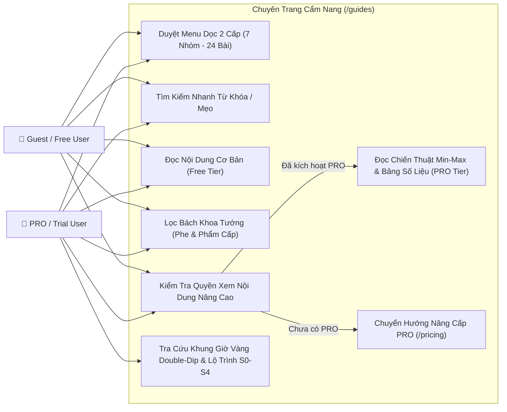
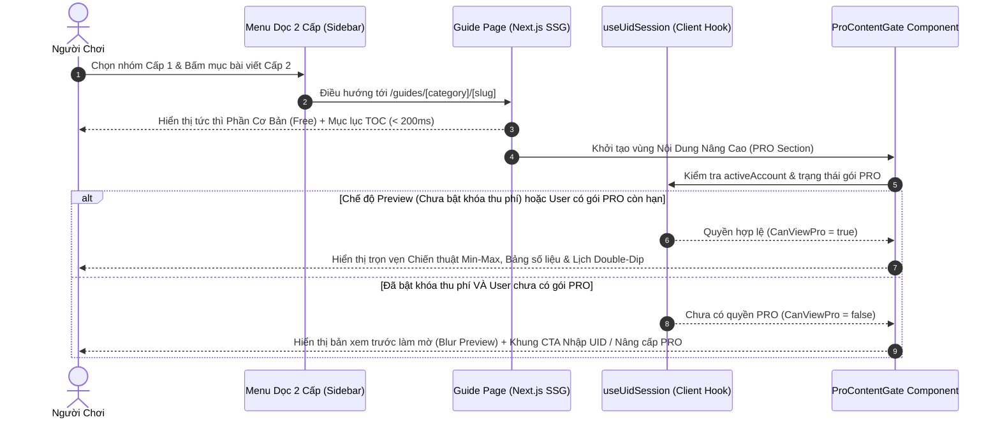

# 📘 Đặc Tả Yêu Cầu & Thiết Kế Kiến Trúc — Chuyên Trang Cẩm Nang (`Guides Hub`)

> **Version:** 1.0 · **Ngày:** 2026-10-15 · **Trạng thái:** Approved Concept — Sẵn sàng lập Implementation Plan
> **Liên quan:** [platform-requirements.md](platform-requirements.md) · [06-game-guides/README.md](../06-game-guides/README.md) · [header.tsx](../../tophub-web/src/components/header.tsx)

---

## 1. Tổng Quan & Tầm Nhìn Sản Phẩm (Overview & Vision)

### 1.1. Bối cảnh & Mục tiêu kinh doanh
Hiện tại, `tophub-web` đã vận hành ổn định luồng **Automation (Nhập Game UID, Tự động điểm danh hàng ngày, Tự động săn & nạp Giftcode)**. Tuy nhiên, để biến `TopHub` thành nền tảng đồng hành không thể thiếu hàng ngày (Daily Companion Hub) và tạo động lực mạnh mẽ cho người chơi nâng cấp lên **Gói PRO (1–2 USD/tháng)**, hệ thống cần bổ sung chuyên trang **`Cẩm Nang / Hướng Dẫn` (`/guides`)** trên thanh điều hướng ngang chính.

Kho nội dung của chuyên trang này được xây dựng trực tiếp từ **38 tài liệu chuẩn hóa (~880 KB)** đã đồng bộ từ sổ tay NotebookLM **🎮 Cẩm nang Top Heroes** ([docs/06-game-guides/](../06-game-guides/README.md)), bao phủ toàn diện từ kiến thức nhập môn tân thủ đến 7 chuyên đề chiến thuật Min-Max (Season 0 ➔ Season 4), Bách khoa toàn thư Tướng và Thư viện bảng số liệu định lượng (`TopHeroes Tables`).

### 1.2. Chiến lược Phân tầng Nội dung & Thương mại hóa (Freemium ➔ PRO Gating)
Mỗi trang hướng dẫn được thiết kế theo cấu trúc phân tầng rõ rệt:
1. **Tầng Cơ Bản (Free / Tân Thủ):** Luôn mở miễn phí 100% cho mọi người truy cập (Guest & Free User). Cung cấp kiến thức nền tảng, quy tắc cốt lõi, cảnh báo bẫy cơ bản để thu hút lưu lượng truy cập tự nhiên (SEO) và xây dựng niềm tin cộng đồng.
2. **Tầng Nâng Cao & Công Cụ Chuyên Sâu (PRO Exclusive / Min-Maxer):** Bao gồm các chiến thuật tối ưu sâu (Lộ trình chuyển giao Bộ Lạc chi tiết từng ngày, khung giờ vàng Double-Dip 4 tiếng, bảng chi phí định lượng cấp cao Lv.20➔Lv.40 & 5 Sao Đỏ, mốc ngưỡng đóng băng tài nguyên).
   - **Giai đoạn hiện tại (User Acquisition):** Cho phép trải nghiệm (hoặc gắn huy hiệu `PRO Preview`) để người dùng thấy giá trị thực tế.
   - **Giai đoạn Thương mại hóa (Monetization Active):** Tự động khóa phần nội dung nâng cao bằng lớp bảo vệ `<ProContentGate />` — chỉ hiển thị trọn vẹn khi tài khoản UID đang kích hoạt có trạng thái **PRO / Trial PRO còn hạn**.

---

## 2. Các Quyết Định Thiết Kế Đã Xác Nhận (Confirmed Design Decisions)

Dưới đây là 3 quyết định kiến trúc cốt lõi đã được Product Owner xác nhận trong phiên Brainstorming & BA Elicitation:

| Hạng mục | Phương án đã chốt | Chi tiết triển khai kỹ thuật |
| :--- | :--- | :--- |
| **1. Tổ chức nội dung Cơ bản vs Nâng cao (PRO)** | **Phương án A:** Chung 1 luồng bài viết + Phân tầng bằng Khung/Tab & Khóa PRO (`<ProContentGate />`) | • Trong cùng 1 trang chủ đề, phần đầu là **🟢 Kiến thức Cơ bản (Miễn phí)**. • Phần sau là **👑 Chiến thuật Nâng cao & Bảng số liệu Min-Max (Dành riêng cho PRO)**. • Tích hợp sẵn biến cấu hình `ENABLE_PRO_CONTENT_LOCK` để bật/tắt chế độ khóa thu phí bất kỳ lúc nào mà không cần sửa lại cấu trúc bài viết. |
| **2. Kiến trúc lưu trữ & Render dữ liệu** | **Phương án A:** Structured Content tĩnh ngay trong Codebase (`tophub-web`) | • Lưu trữ dữ liệu chuẩn hóa dưới dạng TypeScript/JSON/Markdown cấu trúc trong `tophub-web/src/content/guides/` (kết xuất từ `docs/06-game-guides/`). • Tận dụng Static Site Generation (SSG) của Next.js App Router: tốc độ tải trang `< 200ms`, chuẩn SEO, không tốn tải MySQL/Redis của VPS Bot. |
| **3. Phạm vi tiện ích tương tác (MVP Interactive UI)** | **Phương án A:** Rich Docs UI + Tìm kiếm nhanh + Bộ lọc Bách khoa Tướng + Lịch Sự kiện Trực quan | • Hệ thống Callout (Cảnh báo bẫy đỏ, Mẹo vàng, Kỷ luật thép). • Thanh tìm kiếm nhanh (`Quick Search`) lọc bài viết và từ khóa tức thì. • Bộ lọc Bách khoa Tướng theo **Phe phái** (*Liên Minh / Bộ Lạc / Thiên Nhiên*) & **Phẩm cấp** (*Đỏ / Vàng / Tím*). • Bảng Lịch Sự Kiện xoay vòng **Tuần A ⇄ Tuần B** và đồng hồ/khung giờ vàng **Double-Dip 4 tiếng**. |

---

## 3. Kiến Trúc Điều Hướng 3 Tầng & Khung Menu Dọc (Navigation Hierarchy)

### 3.1. Ba tầng điều hướng trên giao diện (`Desktop` & `Mobile`)
1. **Tầng Ngang (Global Top Header):** Thêm mục **`Cẩm Nang` (`Guides`)** (icon `BookOpen`) vào thanh menu ngang tại [header.tsx](../../tophub-web/src/components/header.tsx#L46-L50) bên cạnh `Trang Chủ`, `Săn Giftcode`, `Tra Cứu Bot`.
2. **Tầng Dọc Bên Trái (2-Level Left Sidebar Tree):**
   - **Cấp 1 (Nhóm Danh Mục — Category Group):** Gồm **7 nhóm lớn** có biểu tượng riêng, hỗ trợ đóng/mở (Accordion).
   - **Cấp 2 (Trang Chuyên Đề — Guide Article):** Nằm trong từng nhóm Cấp 1, gồm **24 trang chuyên đề** cụ thể. Mỗi mục có gắn nhãn phân loại (`Free`, `PRO`, `Mới`).
   - *Trên Mobile (`< 1024px`):* Menu dọc tự động thu gọn thành thanh chọn nhanh + ngăn kéo trượt ngang (`Sheet / Drawer`) đạt chuẩn vùng chạm `>= 44px`.
3. **Tầng Mục Lục Trong Trang (Right-side "Trên Trang Này" / TOC):**
   - Hiển thị trên màn hình rộng (`>= 1280px`), liệt kê các tiêu đề `H2 / H3` trong bài đang đọc (kèm biểu tượng ổ khóa `👑 PRO` ở các mục nâng cao) để nhảy nhanh chỉ bằng 1 cú click.

### 3.2. Danh sách chi tiết Khung Menu Dọc (7 Nhóm Cấp 1 ➔ 24 Trang Cấp 2)

| Cấp 1: Nhóm Menu Dọc | Cấp 2: Mã & Tên Trang Hướng Dẫn (`Slug`) | Phân tầng Nội dung (`Free` vs `PRO`) | Nguồn dữ liệu gốc (`docs/06-game-guides/`) |
| :--- | :--- | :--- | :--- |
| **1. 🌱 Nhập Môn Tân Thủ** `/guides/getting-started` | • `1.1` Toàn cảnh lối chơi & Tính năng cốt lõi (`overview`) • `1.2` Quy tắc 1 Hàng khắc nghiệt (`strict-one-queue-rule`) • `1.3` Cẩm nang tiêu Kim Cương hiệu quả nhất (`diamond-guide`) • `1.4` Phân luồng lối chơi: Cày chay (F2P) vs Nạp ít (`f2p-vs-spender`) • `1.5` Tổng hợp những "Cái Bẫy" làm thọt tài khoản (`common-traps`) | • **1.1 – 1.3:** 🟢 100% Free • **1.4 – 1.5:** 🟢 Cơ bản Free + 👑 Danh sách gói nạp tối ưu & Bẫy Mid-game PRO | `05-events-and-community-guides/beginner-guide-topheroes.md` `reddit-best-diamond-spending-guide.md` `gameplay-and-core-features-2game.md` |
| **2. 🦸 Anh Hùng & Đội Hình** `/guides/heroes` | • `2.1` Bách khoa toàn thư Tướng — Bộ lọc 3 Phe & 4 Phẩm cấp (`encyclopedia`) • `2.2` Vòng tròn khắc chế, Hào quang Phe & Xếp trận 2-2-2 (`formation-and-counters`) • `2.3` Động cơ Kinh tế Tướng Tím — Mốc 12 sao & Bẫy 2.000 KC (`epic-hero-traits`) • `2.4` Kỷ luật đóng băng Mảnh Vạn Năng Cam & Sách Kỹ Năng (`shards-and-skill-books`) • `2.5` Đội hình Meta mạnh nhất theo từng Phe S0➔S4 (`meta-lineups`) | • **2.1 – 2.2:** 🟢 100% Free • **2.3 – 2.5:** 🟢 Nguyên tắc chung Free + 👑 Bảng ưu tiên nâng Tướng Tím, Lịch xả mảnh & Đội hình Meta Endgame PRO | `01-core-strategic-topics/topic-1-heroes-1queue-rule-epic-traits.md` `02-heroes-and-lineups/danh-sach-tuong-top-heroes-studio.md` `best-teams-meta-2026-mobigg.md` |
| **3. 🏰 Hạ Tầng & Công Nghệ** `/guides/infrastructure` | • `3.1` Lộ trình đua Lâu Đài & Doanh Trại mốc 25 ➔ 30 (`castle-and-barracks`) • `3.2` Chiến thuật phân bổ 3 Hàng đợi Xây dựng & Chuẩn bị Trại Bộ Lạc (`builder-queues`) • `3.3` Cây Công nghệ Viện Nghiên cứu — 2 Hàng đợi ưu tiên (`research-tech-tree`) • `3.4` Mẹo giữ nốt ngắn nhánh Kinh Tế & Mỏ cấp thấp làm "mồi" sự kiện (`event-baiting-tricks`) | • **3.1:** 🟢 100% Free • **3.2 – 3.4:** 🟢 Tổng quan Free + 👑 Ma trận phân bổ 3 đội thợ/2 hàng đợi nghiên cứu & Mẹo ngâm công trình PRO | `01-core-strategic-topics/topic-2-and-4-buildings-and-research-tech.md` `04-account-audits/buildings-and-barracks-screenshot-audit.md` `research-completion-and-next-steps.md` |
| **4. ⚔️ Trang Bị & Rèn Đúc** `/guides/gear` | • `4.1` Phân biệt 3 hệ thống: Đồ Tướng vs Đồ Lãnh Chúa vs Vũ khí Độc quyền (`gear-overview`) • `4.2` Giải mã 3 Bộ Trang bị Vàng: Đại Đế, Nộ Huyết, Quang Vinh (`golden-gear-sets`) • `4.3` Cơ chế Cộng hưởng Cường hóa (+10 ➔ +40) & Đột phá 5 Sao Đỏ (`enhancement-and-mythic`) • `4.4` Chiến thuật tích xả Trang bị Lãnh chúa (Lord Gear) ăn điểm lớn (`lord-gear-strategy`) • `4.5` Quy tắc Tái chế 100% Quặng & Cách cày Quặng/Ruby mỗi đêm (`ore-farming-and-recycle`) | • **4.1:** 🟢 100% Free • **4.2 – 4.5:** 🟢 Giới thiệu bộ đồ Free + 👑 Bảng ghép chuẩn từng tướng, Bảng chi phí Quặng/Thỏi Vàng & Lịch xả Lord Gear PRO | `01-core-strategic-topics/topic-3-hero-gear-lord-gear-exclusive-weapon.md` `04-account-audits/gear-optimization-consultation.md` `gear-set-and-enhancement-master-qa.md` |
| **5. 🛒 Tiệm, Tiền Tệ & Quân Trang** `/guides/economy` | • `5.1` Bảng xếp hạng ưu tiên mua sắm trong toàn bộ các Tiệm (`shops-tier-list`) • `5.2` Kỷ luật Ngưỡng Đóng Băng 12.000–18.000 Xu xanh chờ Đá Linh Hồn S1 (`guild-honor-freeze`) • `5.3` Tối ưu Tiệm Đổi Quà (Tướng Tím 15 sao), Tiệm VIP & Đấu Trường (`exchange-and-vip-shops`) • `5.4` Hệ thống Quân Trang / Skin Lính & Thời điểm xả Huân chương (`troop-skins-and-medals`) | • **5.1:** 🟢 Danh mục cơ bản Free • **5.2 – 5.4:** 👑 Ngưỡng đóng băng tiền tệ, công thức thức tỉnh Tướng Cam lên Đỏ ở S1 & Đồng bộ mua sắm theo Tuần A/B PRO | `01-core-strategic-topics/topic-5-shops-currencies-military-gear.md` `04-account-audits/event-shopping-consultation.md` |
| **6. 📅 Chiến Thuật Sự Kiện** `/guides/events` | • `6.1` Quy luật Chu kỳ Xoay vòng 2 Tuần: Tuần A ⇄ Tuần B (`biweekly-rotation`) • `6.2` Tuần A — Thi Đấu Hội (Guild Race): Xoay Nhiệm vụ Vàng & Né bẫy (`week-a-guild-race`) • `6.3` Tuần B — Đua Vũ Trang (GAR / KvK / Top Lord): Lịch xả 6 ngày (`week-b-arms-race`) • `6.4` Bí quyết Double-Dip (Ăn điểm kép) canh trùng khung giờ 4 tiếng (`double-dip-schedule`) | • **6.1:** 🟢 100% Free • **6.2 – 6.4:** 🟢 Lịch tổng quan Free + 👑 Bảng điểm chi tiết từng nhiệm vụ Vàng, Khung giờ vàng 4 tiếng & Chiến thuật găm điểm PRO | `01-core-strategic-topics/topic-6-biweekly-event-schedule-week-a-b.md` `05-events/top-heroes-event-schedule-studio.md` `event-strategy-hub-guide.md` |
| **7. 🗺️ Lộ Trình Mùa Giải & Số Liệu** `/guides/roadmap-and-tables` | • `7.1` Lịch ra mắt 6 Tướng Đỏ Pre-Season: Ngày 21, 27, 35, 41, 46 (`preseason-mythic-calendar`) • `7.2` Lộ trình 3 Bước Chuyển giao Liên Minh ➔ Bộ Lạc (`horde-pivot-roadmap`) • `7.3` Chiến lược xuyên Mùa giải S1 ➔ S4: Wukong, Beastmaster, Shadow Priest (`season-1-to-4-roadmap`) • `7.4` Thư viện Bảng số liệu gốc (`TopHeroes Tables`): Runes, Lord Gear, Faction Lv.1–80 (`master-data-tables`) | • **7.1:** 🟢 Lịch cơ bản Free • **7.2 – 7.4:** 👑 Lộ trình 3 bước Horde Pivot không lệch 1 mảnh tướng, Kế hoạch nhịn S1 bung S2/S3 & Toàn bộ bảng số liệu định lượng PRO | `01-core-strategic-topics/topic-7-server-timeline-s0-s4-horde-pivot.md` `03-data-tables/topheroes-tables-analysis-summary.md` `topheroes-tables-max-raw-dataset.md` |

---

## 4. Phạm Vi Dự Án (Scope Definition)

### 4.1. Trong phạm vi (In-Scope)
- Thêm mục `Cẩm Nang` (`/guides`) vào thanh điều hướng Desktop và Mobile Drawer trên `tophub-web`.
- Xây dựng Layout 3 cột cho trang `/guides` (Cột trái: Menu dọc 2 cấp có ô tìm kiếm nhanh; Cột giữa: Nội dung bài viết Rich UI + Công cụ tương tác; Cột phải: Mục lục neo `On this page` + Thẻ trạng thái tài khoản UID/PRO).
- Xây dựng Component `<ProContentGate />` hỗ trợ 2 chế độ:
  - Chế độ **Mở/Preview** (hiển thị nhãn `👑 Kiến thức PRO` nhưng vẫn cho đọc trong giai đoạn thu hút user).
  - Chế độ **Khóa/Paywall** (làm mờ phần nội dung nâng cao với khách hoặc tài khoản Free, hiển thị nút `Nhập UID kiểm tra gói PRO` hoặc `Nâng cấp PRO chỉ từ 1-2$/tháng` dẫn sang `/pricing`).
- Chuyển hóa toàn bộ kho dữ liệu từ `docs/06-game-guides/` thành nội dung chuẩn hóa cho 7 Nhóm – 24 Trang chuyên đề.
- Tích hợp 3 tiện ích tương tác ngay trên trang Guide:
  1. **Tìm kiếm nhanh (`Quick Search`)** theo tiêu đề, từ khóa, tên tướng, vật phẩm.
  2. **Bách khoa Tướng tương tác** (Lọc theo Phe phái, Phẩm cấp, Vai trò).
  3. **Bảng Lịch Sự kiện Tuần A / Tuần B & Khung giờ Double-Dip** trực quan.
- Hỗ trợ đa ngôn ngữ (`vi` hoàn chỉnh 100% và cấu trúc fallback/bản dịch `en`).

### 4.2. Ngoài phạm vi giai đoạn này (Out-of-Scope)
- Hệ thống CMS soạn thảo bài viết trong Admin Dashboard (sử dụng Structured Content tĩnh trong repo theo Quyết định #2).
- Nhận diện ảnh chụp màn hình tự động bằng AI OCR (sẽ xét ở các phase mở rộng sau).

---

## 5. Tác Nhân & Phân Quyền Truy Cập (Actors & Permissions)

| Actor (Tác nhân) | Trạng thái Phiên (`useUidSession`) | Quyền hạn trên chuyên trang `/guides` |
| :--- | :--- | :--- |
| **Guest (Khách vãng lai)** | Chưa nhập UID trên thiết bị | • Xem toàn bộ cây menu 7 nhóm – 24 bài viết. • Sử dụng thanh tìm kiếm nhanh, xem toàn bộ phần **🟢 Kiến thức Cơ bản (Free)**. • Khi cuộn tới phần **👑 Chiến thuật Nâng cao (PRO)**: Nếu bật chế độ khóa, hiển thị khung nhắc nhập UID hoặc nâng cấp PRO. |
| **Free UID User** | Đã chọn UID nhưng gói `FREE` / `EXPIRED` | • Như Guest + Hiển thị thông tin nhân vật (`Nickname`, `Server`) ngay góc trang Guide. • Khi chạm vào nội dung khóa `PRO`, nút CTA mở trực tiếp trang nâng cấp PRO cho đúng UID đang chọn. |
| **PRO / Trial UID User** | Đã chọn UID có gói `PRO` hoặc `TRIAL` còn hạn | • **Mở khóa 100%** toàn bộ nội dung **👑 Chiến thuật Nâng cao**, lộ trình Horde Pivot, khung giờ vàng Double-Dip và toàn bộ bảng số liệu `TopHeroes Tables`. |

---

## 6. Mô Hình Hóa Hệ Thống (System Modeling — Mermaid UML)

### 6.1. Sơ đồ Use Case — Tương tác Người dùng trên `Guides Hub`
**Mục đích:** Mô tả ranh giới quyền hạn giữa Khách/Người dùng Miễn phí và Người dùng PRO khi tương tác với các thành phần trong chuyên trang `/guides`.

**Từ điển dữ liệu (Data Dictionary):**
- `Guest / Free User`: Người chơi chưa liên kết UID hoặc UID đang ở gói Miễn phí.
- `PRO / Trial User`: Người chơi có `activeAccount` sở hữu gói PRO trả phí hoặc 7 ngày dùng thử còn hiệu lực.
- `uc_pro_gate`: Component `<ProContentGate />` kiểm tra trạng thái gói cước và cờ cấu hình khóa thu phí.

---

### 6.2. Sơ đồ Tuần tự (Sequence Diagram) — Luồng Hiển thị Bài viết & Kiểm tra Quyền PRO
**Mục đích:** Minh họa luồng xử lý từ lúc người dùng chọn một mục trên Menu dọc cho đến khi hiển thị nội dung Cơ bản và mở khóa (hoặc che mờ) nội dung PRO.

**Từ điển dữ liệu (Data Dictionary):**
- `Guide Page (Next.js SSG)`: Trang tĩnh được biên dịch sẵn từ kho dữ liệu cấu trúc trong codebase.
- `useUidSession`: Hook quản lý danh sách UID đã lưu trên trình duyệt và trạng thái gói dịch vụ của nhân vật đang chọn.
- `CanViewPro`: Biến boolean quyết định việc mở khóa hoàn toàn hay hiển thị màn chắn nâng cấp PRO.

---

## 7. Yêu Cầu Chức Năng & Tiêu Chí Nghiệm Thu Đơn Nguyên (Atomic Acceptance Criteria)

### 7.1. Điều hướng & Bố cục Menu (Navigation & Layout)
- **AC-1.1:** `GIVEN` người dùng ở bất kỳ trang nào trên `tophub-web` `WHEN` nhìn lên thanh Header ngang (hoặc mở Mobile Menu Sheet) `THEN` thấy mục `Cẩm Nang` (`/guides`) hiển thị rõ ràng và làm nổi bật (active state) khi đang ở trong nhánh `/guides/*`.
- **AC-1.2:** `GIVEN` người dùng truy cập `/guides` `WHEN` nhìn vào cột Menu dọc bên trái `THEN` thấy đúng **7 nhóm danh mục Cấp 1** có thể đóng/mở (Accordion) và **24 mục chuyên đề Cấp 2** bên trong.
- **AC-1.3:** `GIVEN` người dùng đang xem một bài viết Cấp 2 bất kỳ `WHEN` kéo xuống cuối bài `THEN` thấy nút điều hướng **`Bài trước (Previous)`** và **`Bài tiếp theo (Next)`** để đọc liền mạch theo lộ trình.

### 7.2. Tìm kiếm nhanh & Bộ lọc tương tác (Interactive Widgets)
- **AC-2.1:** `GIVEN` người dùng gõ từ khóa vào ô tìm kiếm trên Menu dọc (ví dụ: `"Đấu Sĩ"`, `"2000"`, `"Dây gai"`, `"Tuần A"`) `WHEN` chuỗi nhập có từ 2 ký tự trở lên `THEN` danh sách bài viết khớp tiêu đề/từ khóa được lọc ngay lập tức trong `< 100ms` mà không cần tải lại trang.
- **AC-2.2:** `GIVEN` người dùng đang ở trang *Bách khoa toàn thư Tướng* (`/guides/heroes/encyclopedia`) `WHEN` bấm chọn bộ lọc Phe phái (*Liên Minh / Bộ Lạc / Thiên Nhiên*) hoặc Phẩm cấp (*Thần Thoại Đỏ / Huyền Thoại Vàng / Sử Thi Tím*) `THEN` danh sách thẻ tướng cập nhật tức thì theo đúng bộ lọc đã chọn.
- **AC-2.3:** `GIVEN` người dùng đang ở nhóm *Chiến thuật Sự kiện* (`/guides/events/*`) `WHEN` chuyển đổi giữa tab **Tuần A (Thi Đấu Hội)** và **Tuần B (Đua Vũ Trang GAR)** `THEN` hiển thị đúng bảng lịch trình từ Thứ 2 đến Chủ Nhật và các khung giờ vàng Double-Dip 4 tiếng tương ứng.

### 7.3. Phân tầng Cơ bản (Free) & Nâng cao (PRO Gating)
- **AC-3.1:** `GIVEN` người dùng mở bất kỳ trang chuyên đề nào có cả kiến thức cơ bản và nâng cao `WHEN` trang tải xong `THEN` phần **🟢 Kiến thức Cơ bản (Tân thủ / Free)** luôn hiển thị đầy đủ 100% ở nửa trên bài viết.
- **AC-3.2:** `GIVEN` hệ thống đang bật chế độ khóa thu phí (`PRO Lock Active`) `AND` người dùng chưa chọn UID có gói PRO `WHEN` cuộn xuống phần **👑 Chiến thuật Nâng cao (PRO)** `THEN` nội dung nâng cao được che mờ kèm thẻ kêu gọi hành động (`Nhập UID kiểm tra PRO` hoặc `Nâng cấp PRO`).
- **AC-3.3:** `GIVEN` người dùng đang chọn một UID có gói PRO (hoặc hệ thống đang ở giai đoạn mở miễn phí thu hút user) `WHEN` xem phần **👑 Chiến thuật Nâng cao (PRO)** `THEN` toàn bộ bảng biểu, lộ trình và số liệu nâng cao hiển thị sắc nét kèm huy hiệu `👑 PRO`.

---

## 8. Yêu Cầu Phi Chức Năng (Non-Functional Requirements — NFRs)

| Mã NFR | Hạng mục | Chỉ số định lượng bắt buộc |
| :--- | :--- | :--- |
| **NFR-01** | **Hiệu năng tải trang (Performance)** | Thời gian chuyển trang giữa các mục Cấp 2 trên Menu dọc `< 200ms` nhờ cơ chế Prefetch & Static Generation của Next.js. |
| **NFR-02** | **Tải cơ sở dữ liệu (Zero Backend Load)** | `0 query` vào MySQL/Redis của VPS 135 khi người dùng đọc bài viết hướng dẫn (dữ liệu bài viết được đóng gói tĩnh tại tầng Frontend). |
| **NFR-03** | **Trải nghiệm Di động (Mobile UX Core)** | Tất cả các mục trên Menu dọc, nút chuyển Tab và bộ lọc Phe phái có chiều cao vùng chạm tối thiểu `>= 44px`; bảng số liệu rộng có thanh cuộn ngang mượt mà (`overflow-x-auto`) không làm vỡ khung màn hình điện thoại. |
| **NFR-04** | **Đa ngôn ngữ & SEO (i18n & SEO)** | Mỗi trang chuyên đề Cấp 2 có `title` và `meta description` chuẩn SEO theo ngôn ngữ (`vi` / `en`). |

---

## 9. Các Trường Hợp Biên & Xử Lý Ngoại Lệ (Edge Cases & Boundary Conditions)

1. **Tìm kiếm không có kết quả:** Khi người dùng nhập từ khóa không khớp với bất kỳ bài viết nào trong 24 chuyên đề, hiển thị thông báo thân thiện kèm nút *"Xóa bộ lọc"* và gợi ý 3 chuyên đề quan trọng nhất (*Quy tắc 1 Hàng*, *Lịch Sự kiện Tuần A/B*, *Lộ trình Bộ Lạc*).
2. **Truy cập trực tiếp bằng Deep-link vào mục `#anchor` thuộc phần PRO khi đã khóa:** Trang vẫn cuộn tới đúng vị trí tiêu đề của mục đó để người dùng thấy rõ chủ đề mình cần tìm, đồng thời hiển thị khung mở khóa PRO ngay bên dưới tiêu đề.
3. **Gói PRO hết hạn trong lúc đang mở trang:** Khi `useUidSession` phát hiện tài khoản chuyển sang trạng thái hết hạn (và cờ khóa PRO đang bật), giao diện tự động cập nhật lại trạng thái `<ProContentGate />` mà không gây lỗi crash trang.
4. **Bảng dữ liệu lớn (`TopHeroes Tables`):** Không đổ toàn bộ file raw 124 KB ra một bảng duy nhất gây giật lag DOM trên điện thoại; bắt buộc chia thành các Tab gọn nhẹ (*Trang bị Tướng*, *Trang bị Lãnh chúa*, *Cổ ngữ Runes*, *Cấp độ Phe phái*, *Tiệm & VIP*).
