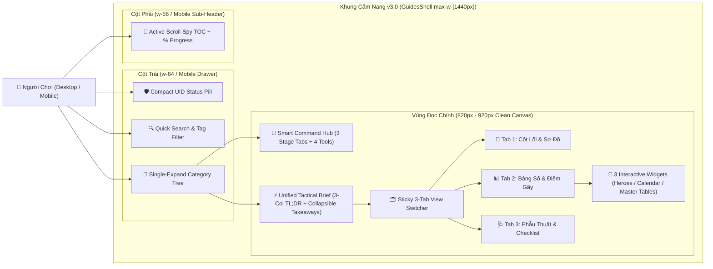
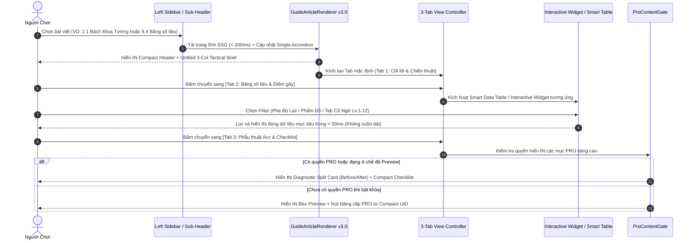

# 📘 Master Plan & Đặc Tả Cải Tổ UI/UX Toàn Diện — Chuyên Trang Cẩm Nang (`Guides Hub v3.0`)

> **Version:** 3.0 (UI/UX Overhaul Master Plan) · **Ngày:** 2026-10-15 · **Trạng thái:** Approved by PO — Sẵn sàng lập Implementation Plan
> **Liên quan:** [guides-hub-requirements-and-design.md](guides-hub-requirements-and-design.md) · [guides-shell.tsx](../../src/components/guides/guides-shell.tsx) · [guide-article-renderer.tsx](../../src/components/guides/guide-article-renderer.tsx)

---

## 1. Tổng Quan & Các Quyết Định Đã Chốt Của Product Owner (Confirmed PO Decisions)

### 1.1. Mục tiêu Cải tổ (Executive Summary)
Tài liệu này hợp nhất toàn bộ kết quả **Kiểm toán UI/UX (Deep UI/UX Audit)**, **Phân tích Yêu cầu Nghiệp vụ (BA Elicitation)** và **Đề xuất Tái thiết kế 2 Cấp độ** cho chuyên trang **Cẩm Nang (`/guides`)** trên `tophub-web`. Mục tiêu cốt lõi là giải quyết triệt để tình trạng *"bức tường chữ và hộp lồng hộp (wall of text & box-in-box fatigue)"*, mở rộng vùng đọc chính thêm **+65%–80%**, giảm **60%–75%** chiều dài cuộn dọc, và kích hoạt đầy đủ các công cụ tra cứu tương tác cho 8 danh mục lớn (31 bài viết).

### 1.2. Ba Quyết Định Thiết Kế Cốt Lõi Đã Được Product Owner Xác Nhận

| Mã Quyết Định | Hạng mục Thiết kế | Phương án Đã Chốt (Confirmed by PO) | Chi tiết Kỹ thuật & UX Áp dụng |
| :--- | :--- | :--- | :--- |
| **DEC-UX-01** | **Cơ chế Thu gọn Chiều dài Bài viết (`Progressive Disclosure`)** | **Phương án A:** Chia bài viết thành **3 Tab Ngang Cố Định (`3-Tab Article View Mode`)** dưới Header | • Phân lớp nội dung bài viết thành 3 chế độ xem rõ rệt:   1. `🎯 1. Cốt lõi & Chiến thuật` (Giải thích cơ chế, Sơ đồ luồng, Quy tắc sinh tồn)   2. `📊 2. Bảng số liệu & Điểm gãy` (Các bảng định lượng, Mốc cộng hưởng, Chi phí)   3. `🩺 3. Phẫu thuật Acc & Checklist` (Case Study Before/After, Phác đồ cấp cứu, Checklist tương tác) • Hỗ trợ thêm nút chuyển nhanh `[Xem tất cả (All-in-One)]` với các mục `H2/H3` dạng Collapsible cho người dùng muốn đọc liền mạch hoặc tìm kiếm `Ctrl+F`. |
| **DEC-UX-02** | **Vị trí Thẻ Trạng thái Nhân vật (`Active Companion UID`)** | **Phương án A:** Chuyển thành **`Compact Status Pill`** | • Gỡ bỏ khối thẻ `Active Companion UID Card` cồng kềnh khỏi cột phải (`GuidesToc`). • Tích hợp thành thanh trạng thái siêu gọn (`Compact Status Pill`: `🟢 [Nickname] • S[Server] • 👑 PRO`) đặt ngay trên đỉnh Left Sidebar (Desktop) và trên thanh Sticky Sub-Header (Mobile). • Giải phóng 100% không gian cột phải cho **Mục lục Scroll-Spy TOC** và thanh tiến độ đọc bài (`Reading Progress %`). |
| **DEC-UX-03** | **Phạm vi & Lộ trình Cải tổ (`Execution Scope`)** | **Phương án Đồng bộ:** Thực thi trọn vẹn **Bước 1 (Macro Layout & Hub)** + **Bước 2 (Micro Article, 8 Blocks & 8 Categories)** | • Triển khai có hệ thống qua 4 Phase: (Phase 1) Kiến trúc Layout 3 cột, Sidebar, Scroll-Spy TOC & Hub Overview ➔ (Phase 2) `GuideArticleRenderer v3.0` & 8 Content Blocks ➔ (Phase 3) 3 Interactive Widgets (`HeroEncyclopedia`, `BiweeklyCalendar`, `MasterDataExplorer`) ➔ (Phase 4) Tinh chỉnh UX chuyên biệt cho 8 Danh mục (31 bài viết) & Kiểm thử đa thiết bị. |

---

## 2. Báo Cáo Kiểm Toán Hiện Trạng & Bắt Bệnh UI/UX (Deep UI/UX Audit Findings)

### 2.1. Bố cục 3 cột "Bóp nghẹt" Vùng đọc chính (Viewport Starvation)
* **Hiện trạng trong mã nguồn:**
  * [`guides-shell.tsx`](../../src/components/guides/guides-shell.tsx) giới hạn khung nhìn ở `max-w-7xl` (`1280px`) với `px-6` (`48px`) và `gap-8` (`32px`).
  * [`guides-sidebar.tsx`](../../src/components/guides/guides-sidebar.tsx) chiếm cứng `xl:w-80` (`320px`).
  * [`guides-toc.tsx`](../../src/components/guides/guides-toc.tsx) chiếm cứng `w-64` (`256px`) kèm khoảng cách `xl:gap-8` (`32px`).
* **Hệ quả định lượng:** Trên màn hình chuẩn `1280px`, chiều rộng còn lại cho cột bài viết chỉ là:
  $$1280\text{px} - 48\text{px (padding)} - 320\text{px (Left Sidebar)} - 256\text{px (Right TOC)} - 64\text{px (2 gaps)} = \mathbf{592\text{px}}$$
  Sau khi trừ tiếp padding lồng nhau của `GuideArticleRenderer` (`p-7` = `56px`) và `SubSection` (`p-5` = `40px`), **vùng hiển thị nội dung thực tế chỉ còn `~496px`**.
* **Tác hại trực quan:** Các khối `VisualDiagramBlock` chia 3 cột (`lg:grid-cols-3`) bị ép còn **`~150px`/cột**, khiến chữ bị ngắt dòng vụn vặt (2–3 từ/dòng), kéo dài chiều cao sơ đồ lên gấp 3 lần. Các bảng dữ liệu 7 cột trong `ResponsiveDataTable` luôn bị cuộn ngang chật chội ngay cả trên màn hình PC lớn.

### 2.2. Hội chứng "Hộp chồng Hộp" & Quá tải Màu sắc (Box-in-Box Fatigue & Rainbow Noise)
* **5 lớp khung viền lồng nhau:** Trong [`guide-article-renderer.tsx`](../../src/components/guides/guide-article-renderer.tsx) và các component trong `blocks/*`, mọi cấp độ phân tầng đều dùng khung viền bo tròn (`border` + `rounded-2xl/3xl` + `bg-*`):
  $$\text{Article Wrapper (\texttt{rounded-3xl border})} \supset \text{SubSection (\texttt{rounded-2xl border})} \supset \text{VisualDiagram (\texttt{rounded-2xl border})} \supset \text{Branch (\texttt{rounded-2xl border})} \supset \text{Step Node (\texttt{rounded-xl border})}$$
* **Bão hòa màu sắc cảnh báo:** Trong cùng 1 màn hình (1 viewport), người đọc bị tấn công đồng thời bởi 4–5 tông màu rực (`amber-500`, `emerald-500`, `rose-500`, `sky-500`) từ `TldrActionBox` ➔ `KeyTakeaways` ➔ `CalloutBox` ➔ `MediaSpotlight`. Khi mọi đoạn văn đều được đóng khung và tô màu cảnh báo, mắt người đọc mất hoàn toàn tiêu điểm (Visual Hierarchy Collapse).

### 2.3. Cuộn dọc vô tận & Trùng lặp Thông tin Mở đầu (Endless Scroll Wall)
* **Hiện trạng:** Các file dữ liệu bài viết dài từ **1.100 đến 2.321 dòng code/bài** (như `2.1-encyclopedia.ts` 128 KB, `8.4-master-data-tables.ts` 154 KB) đang được render phẳng 100% từ trên xuống dưới, tạo ra trang dài từ **8.000px đến 18.000px** (~15–25 màn hình cuộn).
* **Trùng lặp đầu bài:** Khối `TldrActionBox` (3 hộp lớn) và `KeyTakeaways` (3–4 đoạn dài) nằm sát nhau trong Header Card, lặp lại 80% ý tứ của nhau và chiếm mất **1.200px – 1.500px chiều cao** trước khi người đọc chạm tới Mục 1.

### 2.4. Bất cập Điều hướng, Trùng lặp Trang Hub & Chết tính năng Widget
* **Trang Hub (`/guides/page.tsx`) lặp lại 100% Sidebar trái:** Vẽ 8 thẻ Category liệt kê toàn bộ 31 link bài viết ngay bên cạnh `GuidesSidebar` cũng đang liệt kê đúng 8 Category và 31 bài viết đó.
* **Sidebar trái mở sẵn quá nhiều nhóm:** `defaultOpenSlugs` ép mở mặc định 3 nhóm cùng lúc (`getting-started`, `events`, và nhóm đang xem), khiến danh sách bên trái quá dài.
* **Lỗi tiền tố tiêu đề trùng lặp:** Tại [`group-4-server-roadmap.ts`](../../src/content/guides/groups/group-4-server-roadmap.ts), `title.vi` ghi `"Nhóm 4: Lộ Trình Server..."`, khi ghép với `{category.order}. {category.title[locale]}` tạo thành lỗi hiển thị **`"4. Nhóm 4: Lộ Trình Server..."`**.
* **Widget tương tác bị vô hiệu hóa:** Tại dòng 120 của [`guide-article-renderer.tsx`](../../src/components/guides/guide-article-renderer.tsx#L120), `case "widget": return null;` khiến cả 3 widget (`hero_encyclopedia`, `biweekly_event_calendar`, `master_data_tables`) không được hiển thị.
* **Mất hoàn toàn Mục lục (TOC) trên màn hình `< 1280px`:** `GuidesToc` dùng `hidden xl:block`, khiến người dùng Laptop 13 inch, Tablet và Mobile không có công cụ nhảy mục.

---

## 3. Đề Xuất Bước 1 — Cải Tổ Tổng Quan Kiến Trúc Layout, Điều Hướng & Trang Chủ Hub (Macro Layout & IA)

### 3.1. Tái cấu trúc Khung Grid 3 Cột & Phân bổ Độ rộng (Viewport Re-allocation)
1. **Mở rộng Container tổng (`GuidesShell`):** Nâng từ `max-w-7xl` (`1280px`) lên **`max-w-[1440px]`**.
2. **Tinh gọn Left Sidebar (`GuidesSidebar`):**
   * Giảm độ rộng từ `w-80` (`320px`) xuống **`w-64` (`256px`)**, bổ sung nút **Thu gọn Sidebar (`Collapsible Rail [«]`)** để mở rộng tối đa vùng xem bảng dữ liệu khi cần.
   * **Đặt `Compact UID Status Pill` lên đỉnh Sidebar:** Hiển thị gọn trên 1 thanh ngang (`🟢 [Nickname] • S[ID] • 👑 PRO` hoặc nút `Liên kết UID` nếu là Guest).
   * **Chế độ Accordion Đơn (`type="single" collapsible`):** Chỉ tự động mở **duy nhất 1 nhóm danh mục đang active**. Các nhóm còn lại đóng gọn, giúp toàn bộ 3 Phân khu – 8 Nhóm nằm gọn trong `100vh`.
   * **Clean Tree Navigation:** Loại bỏ khung viền nặng nề quanh từng `AccordionItem`; rút gọn tên bài viết trên menu về 1 dòng (`line-clamp-1`) kèm mã số cố định (`1.1`, `1.2`).
3. **Tinh gọn Right Sidebar (`GuidesToc`):**
   * Giảm độ rộng từ `w-64` (`256px`) xuống **`w-56` (`224px`)**.
   * **Active Scroll-Spy (`IntersectionObserver`):** Tự động tô sáng mục `H2/H3` đang đọc khi người dùng cuộn trang, kết hợp thanh **Tiến độ đọc bài (`Reading Progress Bar 0%–100%`)**.
4. **Mở rộng Vùng Đọc Chính (`Main Article Canvas`):**
   * Độ rộng thực tế tăng từ `~496px` lên **`820px – 920px`** (**+65% đến +80% diện tích ngang**).

### 3.2. Tái thiết kế Trang chủ `/guides` thành "Smart Command Hub" (4 Tầng)
1. **Tầng 1 — Compact Hero & Global Command Search (`⌘K`):**
   * Banner tinh gọn kèm thanh tìm kiếm trung tâm và các thẻ từ khóa tìm kiếm nhanh (*`#560Mảnh`*, *`#9HồnĐáĐỏ`*, *`#DoubleDip`*, *`#HordePivot`*, *`#Brawler12Sao`*).
2. **Tầng 2 — Bộ Chọn Giai Đoạn Máy Chủ (`Server Stage Selector` — 3 Tabs):**
   * Cá nhân hóa lộ trình đọc theo tuổi server của người chơi (mỗi Tab đề xuất đúng 3 bài viết trọng tâm + 1 danh sách việc cần làm ngay):
     * 🌱 **Tab 1: Tân Thủ Ngày 1–20 (Pre-Season S0):** *Quy tắc 1 Hàng (`1.2`)* ➔ *10 Cạm bẫy Phế Acc (`1.4`)* ➔ *Lịch Sự kiện Pha 1 (`3.1`)*.
     * 🔥 **Tab 2: Chuyển Hệ Ngày 21–45 (Horde Pivot):** *Lộ trình Chuyển giao Bộ Lạc (`4.2`)* ➔ *Đóng băng Xu Bang chờ 9 Đá Đỏ (`7.2`)* ➔ *Bộ Đồ Vàng Dấu Hệ +30% (`5.2`)*.
     * 👑 **Tab 3: Chiến Sự S1 ➔ S4 (Endgame Min-Max):** *Giờ Vàng Double-Dip 300% (`3.4`)* ➔ *Đội hình Meta S1–S4 (`2.2`)* ➔ *Lâu đài Quang Huy & Lính T10/T11 (`8.1`)*.
3. **Tầng 3 — Lối Tắt 4 Công Cụ Tra Cứu Tương Tác (`Interactive Tools Strip`):**
   * 4 thẻ Bento nổi bật dẫn thẳng tới: (1) 🦸 *Bách Khoa 45+ Tướng*, (2) 📅 *Lịch Xoay Vòng Tuần A ⇄ Tuần B*, (3) 🛒 *Tier List 13 Cửa Hàng*, (4) 📊 *12 Bảng Số Liệu Gốc (Master Tables)*.
4. **Tầng 4 — Lưới 8 Chuyên Đề Thu Gọn (`Clean 8-Category Bento Grid`):**
   * Mỗi thẻ chuyên đề chỉ hiển thị: Icon + Tên nhóm + Mô tả ngắn 2 dòng + **Nút `"Bắt đầu: Bài X.1"`** + Popover/Accordion nhỏ xem danh sách các bài còn lại (xóa bỏ hoàn toàn việc liệt kê lặp lại 31 dòng link).

### 3.3. Quy tắc "Khử Hộp" (De-Boxing Principle) & Hệ màu 60-30-10
* **De-Boxing:** Xóa bỏ khung bao ngoài của `freeSections` và khung bao mặc định của `SubSections (H3)`. Các mục `H2` phân tách bằng đường kẻ mảnh `border-b border-border/60` và khoảng trắng thoáng đãng.
* **Tỷ lệ màu 60-30-10:** 60% Nền trung tính & chữ độ tương phản chuẩn WCAG AA (`>= 4.5:1`) ➔ 30% Bề mặt thẻ/bảng nhẹ (`bg-card/40`) ➔ 10% Nhấn màu ngữ nghĩa (`Amber` = Core/PRO, `Emerald` = Do/Breakpoint, `Rose` = Taboo/Trap).

### 3.4. Trải nghiệm Mobile & Tablet UX Core (`Sticky Sub-Header Bar`)
* Trên màn hình `< 1280px`, gắn thanh **Sticky Sub-Header Bar (`h-11`)** ngay dưới Header chính gồm:
  * Trái: Nút **`[☰ Danh mục (8 Nhóm)]`** mở ngăn kéo chọn bài + hiển thị `Compact UID Pill`.
  * Phải: Nút **`[📑 Mục lục & Chuyển Tab ▾]`** mở Bottom Sheet / Popover cho phép nhảy nhanh tới mọi mục `H2/H3` và xem `% Tiến độ đọc`.

---

## 4. Đề Xuất Bước 2 — Cải Tổ Chi Tiết Trang Bài Viết, 8 Content Blocks, 3 Widgets & 8 Danh Mục Lớn (Micro UX)

### 4.1. Chuẩn hóa Anatomy của 1 Trang Bài Viết (`GuideArticleRenderer v3.0`)
1. **Compact Hero Header:** Hiển thị Breadcrumb + Mã bài (`#1.1`) + Thời gian đọc + Tiêu đề chính (tách phần thuật ngữ tiếng Anh dài trong ngoặc đơn thành dòng phụ `subtitle` gọn đẹp).
2. **Unified Tactical Brief (Gộp `TL;DR` + `KeyTakeaways`):**
   * Hiển thị **3 Cột Ngang (`md:grid-cols-3`)** cho 3 chỉ thị: `👑 Nguyên tắc số 1` | `⚡ Hành động ngay` | `🚫 Cấm kỵ tuyệt đối`.
   * Tích hợp `KeyTakeaways` thành ngăn kéo **Collapsible (`"📌 Xem 4 định mức số liệu cốt lõi"`)** ngay cạnh đáy hộp TL;DR, tiết kiệm 60% chiều cao đầu bài.
3. **Sticky 3-Tab Article View Mode (Phương án A đã chốt):**
   * Thanh Tab bám dính (`sticky top-16 z-30`) chia nội dung bài viết thành 3 chế độ rõ rệt:
     * **Tab 1 — `🎯 1. Cốt lõi & Chiến thuật`:** Render các mục giải thích cơ chế, sơ đồ trực quan (`visual_diagram`), lộ trình (`roadmap`) và quy tắc nền tảng.
     * **Tab 2 — `📊 2. Bảng số liệu & Điểm gãy`:** Tập hợp toàn bộ các bảng thông số (`table`), mốc điểm gãy định lượng và công cụ tra cứu (`widget`) của bài viết.
     * **Tab 3 — `🩺 3. Phẫu thuật Acc & Checklist`:** Hiển thị kịch bản thực chiến (`case_study`), phác đồ cấp cứu và bảng đánh dấu (`checklist`) lưu `localStorage`.
   * Có nút chuyển nhanh **`[Xem toàn bộ (All)]`** ở góc phải thanh Tab cho người dùng muốn cuộn đọc cả bài.

### 4.2. Đặc tả Tái thiết kế 8 Content Blocks + Khôi phục `GuideWidgetBlock`

| STT | Tên Component | Thiết kế Cải tổ Chi tiết (`v3.0 Spec`) |
| :--- | :--- | :--- |
| **1** | `TldrActionBox` + `KeyTakeaways` | **Unified 3-Column Bento Strip:** 3 cột ngang (`md:grid-cols-3`) cho *Nguyên tắc #1 / Hành động ngay / Cấm kỵ*; tích hợp `KeyTakeaways` vào ngăn kéo Collapsible ngay bên dưới. |
| **2** | `CalloutBox` | **Slim Left-Accent Banner:** Bỏ khung bo 4 cạnh dày; dùng thanh nhấn trái `border-l-4`, nền nhẹ `bg-muted/30`, nhãn pill nhỏ (`[BẪY ĐỎ]`, `[MẸO]`, `[LUẬT THÉP]`). |
| **3** | `ResponsiveDataTable` | **Smart Data Grid:** (1) Ghim cột đầu (`sticky left-0`) & ghim dòng tiêu đề; (2) Tự động highlight dòng chứa `🔥 / ⭐ / 👑`; (3) Bảng `> 8 dòng` mặc định thu gọn ở 6 dòng đầu kèm nút `[Xem đầy đủ N dòng ▾]` + Ô lọc nhanh từ khóa. |
| **4** | `VisualDiagramBlock` | **True Infographic Flow:** Thu gọn văn bản trong mỗi node tối đa 2 dòng (bấm/hover để xem chi tiết); bổ sung mũi tên kết nối luồng (`──►` ngang / `▼` dọc) giữa `centerNode` ➔ `branches` ➔ `outcome`; vẽ thanh bar thực sự cho biến thể `metric_bars`. |
| **5** | `StepRoadmap` | **Interactive Stepper Tabs:** Bổ sung thanh chọn bước ngang (*Bước 1 ➔ Bước 2 ➔ Bước 3 ➔ Bước 4*) để chuyển nhanh nội dung từng giai đoạn mà không cần cuộn dọc. |
| **6** | `CaseStudyBlock` | **Diagnostic Medical File Card:** Hàng trên là thanh 3 chỉ số `Before ➔ After`; hàng dưới chia **2 cột song song (`md:grid-cols-12`)**: Cột trái (5 phần) *Chẩn đoán nguyên nhân*, Cột phải (7 phần) *Phác đồ cấp cứu từng bước*, giảm 50% chiều cao. |
| **7** | `InteractiveChecklistBlock` | **Compact 48px Action Rows:** Mỗi mục chỉ cao `48px` (`Checkbox + Tiêu đề + Badge`); phần giải thích `detail` ẩn trong nút mở rộng `[ⓘ Chi tiết]` bên phải. |
| **8** | `MediaSpotlightBlock` | **Visual Blueprint Card:** `tier1_faction_loop` vẽ sơ đồ tam giác khắc chế 3 hệ trực quan; `tier2_annotated_ui` khi có ảnh thì gắn ghim số `① ② ③`, khi chưa có ảnh thì hiển thị thành **2 cột đối xứng (`✅ Nên làm` vs `🚫 Cấm làm`)** và lược bỏ câu mô tả ảnh thừa. |
| **9** | `GuideWidgetBlock` | **Khôi phục & Render 3 Interactive Widgets:** Thay thế `case "widget": return null` bằng 3 component tương tác thực tế (`HeroEncyclopediaWidget`, `BiweeklyCalendarWidget`, `MasterDataExplorerWidget`). |

### 4.3. Đặc tả UX Chuyên biệt cho 8 Danh Mục Lớn (31 Trang Bài Viết)

| Nhóm Danh Mục | Các Bài Viết (`Code`) | Giải pháp UX & Component Chuyên biệt |
| :--- | :--- | :--- |
| **Mục 1: Nhập Môn & Luật Sống Còn** (`/guides/getting-started`) | `1.1` Overview `1.2` Strict 1-Queue `1.3` Diamond Guide `1.4` Top 10 Traps | • **Bài `1.1` & `1.2`:** Bộ chọn tương tác 7 Trụ cột Sức mạnh (bấm chọn trụ cột để xem chi tiết). • **Bài `1.3`:** Bảng phân hạng Kim Cương S/A/F-Tier trực quan. • **Bài `1.4`:** Chuyển 10 mục con (`Trap #1 ➔ #10`) thành **Bộ lọc 4 Nhóm Hệ thống + Accordion Khám bệnh 1-Click** (*"Tôi đang mắc lỗi này ➔ Xem thuốc giải"*). |
| **Mục 2: Anh Hùng, Tier List & Đội Hình** (`/guides/heroes`) | `2.1` Encyclopedia `2.2` Meta Lineups `2.3` Formation 2×3 `2.4` Shards & Books `2.5` Epic Traits | • **Bài `2.1`:** Tích hợp **`<HeroEncyclopediaWidget />`** lọc tức thì 45+ tướng theo *Phe (Bộ Lạc/Liên Minh/Thiên Nhiên)* × *Phẩm cấp (Đỏ/Vàng/Tím)* × *Vai trò*. • **Bài `2.2` & `2.3`:** Thiết kế **Sàn Đấu 6 Ô Trực Quan (`2×3 Formation Grid`: Ô 1–2 Hàng trước, Ô 3–4 Hàng giữa, Ô 5–6 Hàng sau)** có nút chuyển đội hình theo mùa. • **Bài `2.4` & `2.5`:** Thanh tiến trình Điểm Gãy Sao (`160 ➔ 400 ➔ 🔥 560 (1★ Trắng) ➔ 1,000 Mảnh`). |
| **Mục 3: Lịch Sự Kiện & Double-Dip** (`/guides/events`) | `3.1` Biweekly Rotation `3.2` Week A Guild Race `3.3` Week B GAR/KvK `3.4` Double-Dip Schedule | • **Bài `3.1`:** Tích hợp **`<BiweeklyCalendarWidget />`** chuyển đổi *Pha 1 ⇄ Pha 2 (Tuần A/B)* và tự động highlight Thứ hiện tại trong tuần. • **Bài `3.2`:** Bộ lọc Nhiệm vụ Vàng Thi Đấu Hội (*Phải nhận / Có điều kiện / Bẫy tiêu phí*). • **Bài `3.3`:** Thanh Tab ngang **6 Ngày GAR/KvK (`Thứ 2 ➔ Thứ 7`)**. • **Bài `3.4`:** Công cụ tra cứu nhanh **"Chọn Vật Phẩm ➔ Xem Ngày & Giờ Vàng Xả 300%"**. |
| **Mục 4: Lộ Trình Server & Chuyển Hệ** (`/guides/roadmap`) | `4.1` Pre-Season Calendar `4.2` Horde Pivot `4.3` Season 1–4 Roadmap | • Sửa lỗi tiền tố `"4. Nhóm 4"` trong `group-4-server-roadmap.ts`. • **Bài `4.1`:** Timeline ngang Ngày 1 ➔ Ngày 65 kèm nhãn `[🔥 ALL-IN]` / `[❄️ SKIP]`. • **Bài `4.2`:** **4-Stage Horde Pivot Stepper** hiển thị sự dịch chuyển tướng từ Đội 1 Liên Minh sang Đội 1 Bộ Lạc & Đội 2 Liên Minh. • **Bài `4.3`:** Chia 4 Tab theo mùa (`[Season 1]` \| `[Season 2]` \| `[Season 3]` \| `[Season 4]`). |
| **Mục 5: Trang Bị, Lãnh Chúa & Vũ Khí** (`/guides/gear`) | `5.1` Gear Overview `5.2` Golden Gear Sets `5.3` Enhancement +40 `5.4` Lord Gear Strategy | • **Bài `5.1`:** Bảng đối chiếu 3 cột song song (*Đồ Tướng 0 điểm* vs *Đồ Lãnh Chúa điểm lớn* vs *Vũ khí Độc quyền*). • **Bài `5.2`:** **Ma trận Lò Rèn `3 Hàng × 4 Cột`** (gạch chéo Cột 4 Không Dấu Hệ, tô sáng Cột 1–3 `+30% Stats`). • **Bài `5.3` & `5.4`:** Thanh mốc cộng hưởng `+10/+20/+30/+40` và sơ đồ 6 món Đồ Chúa Tể ưu tiên Nhánh Phải. |
| **Mục 6: Cổ Ngữ, Thánh Vật & Thú Cưng** (`/guides/power-systems`) | `6.1` Runes Guide `6.2` Relics Guide `6.3` Pets & Behemoth | • **Bài `6.1`:** Sơ đồ **6 Ô Khảm Cổ Ngữ** kèm bộ chuyển đổi thông số ở 3 mốc `Lv.5` / `Lv.8` / `Lv.12`. • **Bài `6.2`:** Bộ chọn Bộ 3 Thánh Vật BiS theo 3 Phe (*Ô Công / Ô Thủ / Ô Hỗ trợ*). • **Bài `6.3`:** Chia 2 Tab rõ rệt (`🐾 Thú Cưng Lv.1–120` \| `🦖 Cự Thú Behemoth Lv.1–150`). |
| **Mục 7: Tiệm Mua Sắm, Tiền Tệ & Quân Trang** (`/guides/economy`) | `7.1` Shops Tier List `7.2` Guild Honor Freeze `7.3` Exchange & VIP `7.4` Troop Skins | • **Bài `7.1` – `7.3`:** **Bộ Chọn 13 Cửa Hàng Nhanh (`Shop Selector Pills`)** — chọn tiệm nào hiện ngay **Đáy Ví An Toàn (`Safety Floor`)** và 3 cột hàng hóa (*Nên vét / Mua khi dư / Cấm mua*). • **Bài `7.2`:** Thanh mục tiêu tích lũy **9 Hồn Đá Đỏ (`360K Điểm Vinh Dự / 54K Xu`)**. • **Bài `7.4`:** Bảng tỷ lệ `4:2:1` và mốc Quân Trang `Lv.10/20/30/40/50`. |
| **Mục 8: Hạ Tầng, Công Nghệ & Bảng Số Liệu** (`/guides/infrastructure`) | `8.1` Castle & Brilliance `8.2` Builder & Villagers `8.3` Research & Baiting `8.4` Master Data Tables | • **Bài `8.1` – `8.3`:** Sơ đồ điều phối 4 Hàng đợi Thợ xây & 2 Hàng đợi Nghiên cứu; so sánh chi phí Tinh chất Rồng `Lv.35 T10` & `T11`. • **Bài `8.4`:** Tích hợp **`<MasterDataExplorerWidget />`** chia 12 bảng dữ liệu gốc thành **các Tab độc lập có ô lọc dòng & tìm kiếm tức thì**, chấm dứt hoàn toàn việc render cùng lúc 2.321 dòng dữ liệu. |

---

## 5. Mô Hình Hóa Hệ Thống (System Modeling — Mermaid UML)

### 5.1. Sơ đồ Kiến trúc Bố cục & Luồng Chuyển đổi Chế độ Xem (`v3.0 Layout & View Mode Flow`)
**Mục đích:** Mô tả cấu trúc phân bổ khung nhìn mới (`max-w-[1440px]`) và luồng tương tác của người chơi với thanh `3-Tab Article View Mode`, `Compact UID Pill` và `Interactive Widgets`.

**Từ điển dữ liệu (Data Dictionary):**
- `uid_pill`: Thanh trạng thái nhân vật thu gọn (`Nickname`, `Server`, `PRO/Free`), thay thế thẻ lớn ở cột phải.
- `mode_tabs`: Bộ chuyển đổi 3 chế độ xem bài viết (Phương án A) giúp giảm 60%–75% chiều dài cuộn trang.
- `widgets`: Ba bộ công cụ tương tác (`HeroEncyclopediaWidget`, `BiweeklyCalendarWidget`, `MasterDataExplorerWidget`) được khôi phục trong `GuideArticleRenderer`.
- `scroll_toc`: Mục lục tự động nhận diện vị trí cuộn trang (`IntersectionObserver`) và hiển thị trên cả Mobile qua thanh `Sticky Sub-Header`.

---

### 5.2. Sơ đồ Tuần tự (Sequence Diagram) — Luồng Phân lớp Nội dung 3-Tab & Tra cứu Widget
**Mục đích:** Minh họa trình tự xử lý khi người dùng mở một trang bài viết, chuyển đổi giữa 3 Tab nội dung hoặc tương tác với Widget và kiểm tra quyền `<ProContentGate />`.

**Từ điển dữ liệu (Data Dictionary):**
- `3-Tab View Controller`: State quản lý chế độ hiển thị (`core` | `data` | `action` | `all`), đồng bộ mượt với neo mục lục (`#anchor`) khi người dùng bấm từ `GuidesToc`.
- `Smart Data Table`: Bảng dữ liệu có cột đầu ghim cố định, tự động tô sáng dòng điểm gãy và thu gọn các bảng dài quá 8 dòng.

---

## 6. Yêu Cầu Chức Năng Đơn Nguyên (Atomic Acceptance Criteria), NFRs & Edge Cases

### 6.1. Tiêu chí Nghiệm thu Đơn nguyên (Atomic Acceptance Criteria)
- **AC-UX-1.1 (Viewport & Grid):** `GIVEN` người dùng mở trang `/guides/*` trên màn hình Desktop `>= 1440px` `WHEN` đo kích thước 3 cột `THEN` Left Sidebar rộng `256px` (`w-64`), Right TOC rộng `224px` (`w-56`), và vùng đọc bài viết chính đạt tối thiểu `820px`.
- **AC-UX-1.2 (Single-Accordion Sidebar):** `GIVEN` người dùng đang xem một bài viết thuộc Nhóm `N` `WHEN` nhìn vào Left Sidebar `THEN` chỉ có duy nhất Nhóm `N` được mở sẵn danh sách bài con, 7 nhóm còn lại ở trạng thái đóng gọn.
- **AC-UX-1.3 (Compact UID Status Pill):** `GIVEN` người dùng đã chọn tài khoản UID `WHEN` xem bất kỳ trang nào trong `/guides` `THEN` thấy `Compact UID Status Pill` ở đầu Left Sidebar (Desktop) hoặc Sub-Header (Mobile), và cột phải không còn khối `Active Companion UID Card` cũ.
- **AC-UX-1.4 (Smart Command Hub):** `GIVEN` người dùng truy cập `/guides` `WHEN` bấm chuyển giữa 3 Tab giai đoạn (*Ngày 1–20* / *Ngày 21–45* / *S1–S4*) `THEN` danh sách 3 bài viết trọng tâm cập nhật tức thì và khu vực 8 chuyên đề bên dưới không liệt kê lặp lại toàn bộ 31 dòng link.
- **AC-UX-2.1 (Unified Tactical Brief):** `GIVEN` người dùng mở một bài viết có `tldr` và `keyTakeaways` `WHEN` nhìn vào phần mở đầu `THEN` thấy 3 chỉ thị TL;DR xếp thành 3 cột ngang trên Desktop và phần `keyTakeaways` được thu gọn trong thanh Collapsible ngay bên dưới.
- **AC-UX-2.2 (3-Tab Article View Mode):** `GIVEN` người dùng đang ở trang chi tiết bài viết `WHEN` bấm chọn giữa `[1. Cốt lõi & Chiến thuật]`, `[2. Bảng số liệu & Điểm gãy]`, `[3. Phẫu thuật Acc & Checklist]`, hoặc `[Xem tất cả]` `THEN` vùng nội dung chỉ hiển thị đúng các khối thuộc chế độ đã chọn mà không tải lại trang.
- **AC-UX-2.3 (TOC Deep-Link Sync):** `GIVEN` người dùng đang ở chế độ xem Tab 1 `WHEN` bấm vào một mục lục trên `GuidesToc` (hoặc Mobile TOC) thuộc Tab 2 hoặc Tab 3 `THEN` hệ thống tự động chuyển sang Tab chứa mục đó (hoặc bật chế độ `All`) và cuộn mượt tới đúng `#id` mục tiêu.
- **AC-UX-3.1 (Interactive Widgets):** `GIVEN` người dùng mở bài `2.1` (`encyclopedia`), `3.1` (`biweekly-rotation`), hoặc `8.4` (`master-data-tables`) `WHEN` tương tác với bộ lọc Phe/Phẩm cấp, Tab Tuần A/B, hoặc Tab 12 Bảng số liệu `THEN` giao diện lọc và hiển thị đúng tập dữ liệu tương ứng trong `< 50ms`.

### 6.2. Yêu cầu Phi chức năng (Non-Functional Requirements — NFRs)
| Mã NFR | Hạng mục | Chỉ số Định lượng Bắt buộc |
| :--- | :--- | :--- |
| **NFR-UX-01** | **Tối ưu Chiều dài Trang (Scroll Reduction)** | Giảm tối thiểu **60% chiều cao DOM ban đầu** trên các bài viết dài (`1.4`, `2.1`, `7.1`, `8.4`) nhờ cơ chế 3-Tab và Smart Table Collapse. |
| **NFR-UX-02** | **Chuẩn Vùng Chạm Di Động (Mobile Touch Target)** | 100% các nút chuyển Tab, bộ lọc Phe/Phẩm cấp, thanh Accordion và nút Sticky Sub-Header có kích thước vùng chạm `>= 44×44px`. |
| **NFR-UX-03** | **Bảo toàn SEO & SSG (Zero SEO Regression)** | Nội dung trong các Tab/Collapsible vẫn được render đầy đủ trong HTML tĩnh hoặc hỗ trợ index chuẩn SEO, thời gian chuyển trang `< 200ms`. |

### 6.3. Các Trường hợp Biên (Edge Cases) & Đồng bộ Đa nền tảng (Platform Parity)
1. **Bài viết không có bảng số liệu hoặc không có Case Study:** Nếu một bài viết cụ thể không chứa block `table`/`widget` (hoặc không có `case_study`/`checklist`), Tab tương ứng tự động ẩn đi hoặc hợp nhất thông minh để không bao giờ hiển thị một Tab trống rỗng.
2. **Tìm kiếm trong trang (`Ctrl+F`) hoặc truy cập URL có `#hash`:** Khi URL có `#hash` trỏ tới một mục nằm ở Tab đang ẩn, hook điều khiển Tab tự động kích hoạt đúng Tab chứa `#hash` đó trước khi thực hiện `scrollIntoView`.
3. **Đồng bộ Web vs. Mobile (`Platform Parity`):**
   - **Desktop (`>= 1280px`):** Hiển thị đầy đủ 3 cột (`Left Sidebar w-64` + `Main Canvas` + `Right Scroll-Spy TOC w-56`); `TldrActionBox` hiển thị 3 cột ngang.
   - **Tablet & Mobile (`< 1280px`):** Ẩn 2 cột bên, kích hoạt thanh **Sticky Sub-Header Bar** chứa cả nút mở `Drawer Danh mục` và `Bottom Sheet Mục lục TOC`; bảng số liệu ghim cố định cột đầu tiên (`sticky left-0`) khi vuốt ngang.

---

## 7. Lộ Trình Thực Thi Tổng Thể (Master Execution Roadmap — 4 Phases)

| Phase | Tên Giai Đoạn | Hạng Mục Thực Thi Trọng Tâm | Các File Dự Kiến Tác Động |
| :--- | :--- | :--- | :--- |
| **Phase 1** | **Cải tổ Kiến trúc Layout 3 Cột, Điều hướng & Trang chủ Hub (Bước 1)** | • Mở rộng `GuidesShell` lên `max-w-[1440px]`. • Nâng cấp `GuidesSidebar`: `w-64`, Single-Accordion, Collapsible Rail, gắn `Compact UID Status Pill`, sửa tiền tố `"Nhóm 4"` tại `group-4-server-roadmap.ts`. • Nâng cấp `GuidesToc`: `w-56`, Active Scroll-Spy + Reading Progress %, bổ sung Mobile Sticky Sub-Header TOC. • Tái thiết kế `guides/page.tsx` thành **Smart Command Hub** (3 Stage Tabs + 4 Interactive Tools + Clean 8-Category Grid). | • `guides-shell.tsx` • `guides-sidebar.tsx` • `guides-toc.tsx` • `app/[locale]/guides/page.tsx` • `group-4-server-roadmap.ts` |
| **Phase 2** | **Tái thiết kế `GuideArticleRenderer v3.0` & 8 Content Blocks (Bước 2A)** | • Khử khung lồng nhau (De-Boxing) cho `FreeSections` & `SubSections`. • Gộp `TldrActionBox` + `KeyTakeaways` thành **Unified 3-Column Tactical Brief**. • Triển khai **Sticky 3-Tab Article View Mode** (Phương án A) kèm đồng bộ `#hash` TOC. • Tinh gọn toàn bộ 8 block components (`callout`, `table` có sticky column & collapse, `visual_diagram` có luồng mũi tên, `roadmap` stepper, `case_study` 2 cột, `checklist` 48px, `media_spotlight`). | • `guide-article-renderer.tsx` • `blocks/tldr-action-box.tsx` • `blocks/callout-box.tsx` • `blocks/responsive-data-table.tsx` • `blocks/visual-diagram-block.tsx` • `blocks/step-roadmap.tsx` • `blocks/case-study-block.tsx` • `blocks/interactive-checklist-block.tsx` • `blocks/media-spotlight-block.tsx` |
| **Phase 3** | **Xây dựng & Tích hợp 3 Interactive Widgets (Bước 2B)** | • Khôi phục `case "widget"` trong `GuideArticleRenderer`. • Xây dựng `<HeroEncyclopediaWidget />` cho Mục 2 (`2.1`). • Xây dựng `<BiweeklyCalendarWidget />` & Bộ lọc Ngày/Vật phẩm Double-Dip cho Mục 3 (`3.1`–`3.4`). • Xây dựng `<MasterDataExplorerWidget />` chia Tab & lọc nhanh cho 12 bảng dữ liệu tại Mục 8 (`8.4`). | • `widgets/hero-encyclopedia-widget.tsx` • `widgets/biweekly-calendar-widget.tsx` • `widgets/master-data-explorer-widget.tsx` • `guide-article-renderer.tsx` |
| **Phase 4** | **Tinh chỉnh UX Chuyên biệt cho 8 Danh mục (31 Bài) & Nghiệm thu (Bước 2C)** | • Áp dụng Accordion khám bệnh cho 10 Cạm bẫy (`1.4`), Sàn đấu 2×3 Formation (`2.2`, `2.3`), Stepper Chuyển hệ (`4.2`), Ma trận Lò rèn (`5.2`), Bộ chọn 13 Cửa hàng (`7.1`). • Kiểm tra i18n (`vi`/`en`), Accessibility contrast, Mobile Touch Target `>= 44px` và `npm run build` 0 lỗi. | • Các file dữ liệu/mapping trong `content/guides/` (nếu cần gắn metadata tab/widget) • `messages/vi.json`, `messages/en.json` |
